

[![AGPL-3.0][agpl3-shield]][agpl3]
[![CC BY-SA 4.0][cc-by-sa-shield]][cc-by-sa]

# Background

The purpose of this page is to host the Vignette writing challenge entries. There are a substantial number of R packages on both Bioconductor and GitHub that we will not be able to get to during the course. My goal for the off-weeks is to have the class assist in navigating through the existing vignettes/articles for each package, and write up a basic .qmd file to help anyone trying to use these packages have a simpler learning curve in doing so than they would have otherwise. 

# Bioconductor

## CATALYST

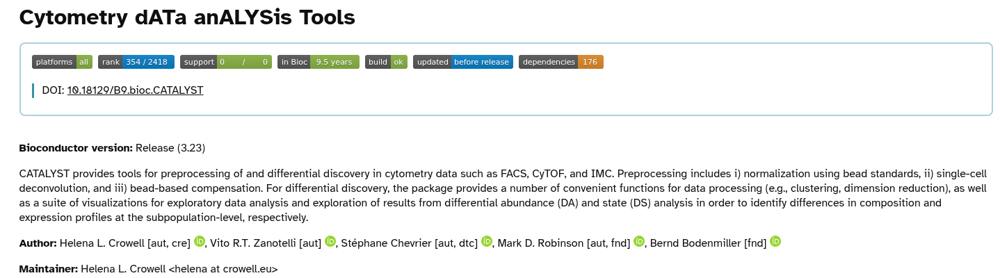

-  [Home]()
-  [Vignettes Preprocessing](https://www.bioconductor.org/packages/3.23/bioc/vignettes/CATALYST/inst/doc/preprocessing.html)
-  [Vignettes Differential Discovery](https://www.bioconductor.org/packages/3.23/bioc/vignettes/CATALYST/inst/doc/differential.html)
-  [GitHub](https://github.com/HelenaLC/CATALYST)
-  [Issues](https://github.com/HelenaLC/CATALYST/issues)
-  [R](https://github.com/HelenaLC/CATALYST/tree/main/R)
-  [tests](https://github.com/HelenaLC/CATALYST/tree/main/tests/testthat)
-  [Build]()

### censcyt

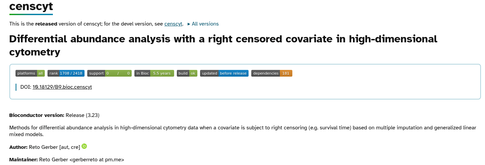

-  [Home](https://bioc.r-universe.dev/censcyt)
-  [Vignettes Censored covariate](https://www.bioconductor.org/packages/3.23/bioc/vignettes/censcyt/inst/doc/censored_covariate.html)
-  [GitHub](https://github.com/retogerber/censcyt)
-  [Issues](https://github.com/retogerber/censcyt/issues)
-  [R](https://github.com/retogerber/censcyt/tree/main/R)
-  [tests](https://github.com/retogerber/censcyt/tree/main/tests/testthat)
-  [Build](https://bioc.r-universe.dev/censcyt#checktable)

### CompensAID

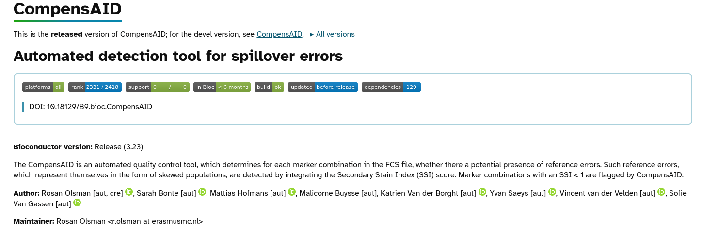

-  [Home](https://bioc.r-universe.dev/CompensAID)
-  [Vignettes Overview](https://www.bioconductor.org/packages/3.23/bioc/vignettes/CompensAID/inst/doc/CompensAID.html)
-  [GitHub](https://github.com/Olsman/CompensAID)
-  [Issues](https://github.com/Olsman/CompensAID/issues)
-  [R](https://github.com/Olsman/CompensAID/tree/main/R)
-  [tests](https://github.com/Olsman/CompensAID/tree/main/tests/testthat)
-  [Build](https://bioc.r-universe.dev/CompensAID#checktable)

### cyanoFilter

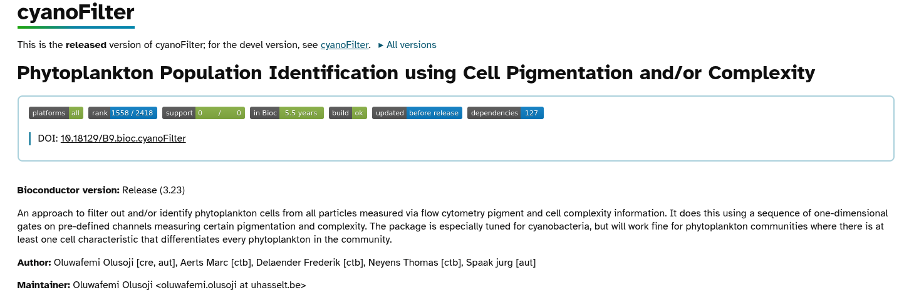

-  [Home](https://bioc.r-universe.dev/cyanoFilter)
-  [Vignettes](https://www.bioconductor.org/packages/3.23/bioc/vignettes/cyanoFilter/inst/doc/cyanoFilter.html)
-  [GitHub](https://github.com/fomotis/cyanoFilter)
-  [Issues](https://github.com/fomotis/cyanoFilter/issues)
-  [R](https://github.com/fomotis/cyanoFilter/tree/master/R)
-  [tests]()
-  [Build](https://bioc.r-universe.dev/cyanoFilter#checktable)

### cydar

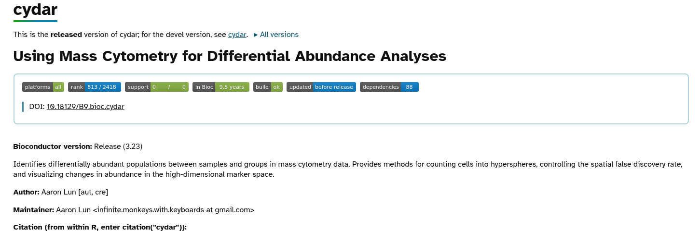

-  [Home](https://bioc.r-universe.dev/cydar)
-  [Vignettes](https://www.bioconductor.org/packages/3.23/bioc/vignettes/cydar/inst/doc/cydar.html)
-  [Build](https://bioc.r-universe.dev/cydar#checktable)

### CytoDx

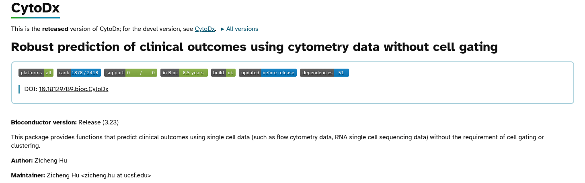

-  [Home](https://bioc.r-universe.dev/CytoDx)
-  [Vignettes](https://www.bioconductor.org/packages/3.23/bioc/vignettes/CytoDx/inst/doc/CytoDx_Vignette.pdf)
-  [Build](https://bioc.r-universe.dev/CytoDx#checktable)

### CyTOFpower

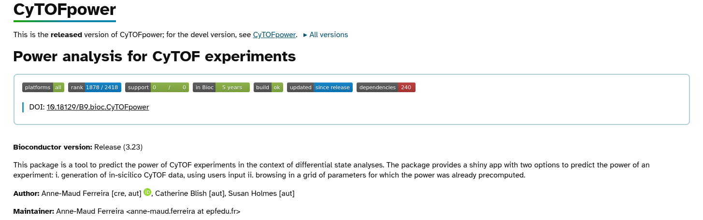

-  [Home]()
-  [Vignettes](https://www.bioconductor.org/packages/3.23/bioc/vignettes/CyTOFpower/inst/doc/CyTOFpower.html)
-  [GitHub]()
-  [Issues]()
-  [R]()
-  [tests]()
-  [Build]()

### CytoGLMM

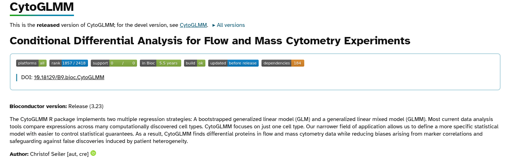

-  [Home]()
-  [Vignettes](https://www.bioconductor.org/packages/3.23/bioc/vignettes/CytoGLMM/inst/doc/CytoGLMM.html)
-  [GitHub](https://github.com/ChristofSeiler/CytoGLMM)
-  [Issues](https://github.com/ChristofSeiler/CytoGLMM/issues)
-  [R](https://github.com/ChristofSeiler/CytoGLMM/tree/devel/R)
-  [tests](https://github.com/ChristofSeiler/CytoGLMM/tree/devel/tests/testthat)
-  [Build]()

### cytoKernel

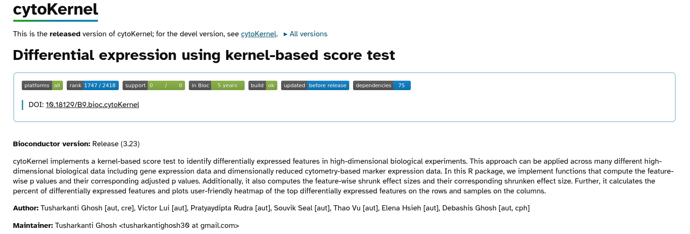

-  [Home]()
-  [Vignettes](https://www.bioconductor.org/packages/3.23/bioc/vignettes/cytoKernel/inst/doc/cytoKernel.html)
-  [GitHub](https://github.com/Ghoshlab/cytoKernel)
-  [Issues](https://github.com/Ghoshlab/cytoKernel/issues)
-  [R](https://github.com/Ghoshlab/cytoKernel/tree/main/R)
-  [tests](https://github.com/Ghoshlab/cytoKernel/tree/main/tests/testthat)
-  [Build]()

### cytolib

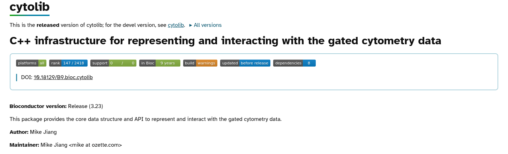

-  [Home]()
-  [Vignettes](https://www.bioconductor.org/packages/3.23/bioc/vignettes/cytolib/inst/doc/cytolib.html)
-  [GitHub]()
-  [Issues]()
-  [R]()
-  [tests]()
-  [Build]()

### CytoMDS

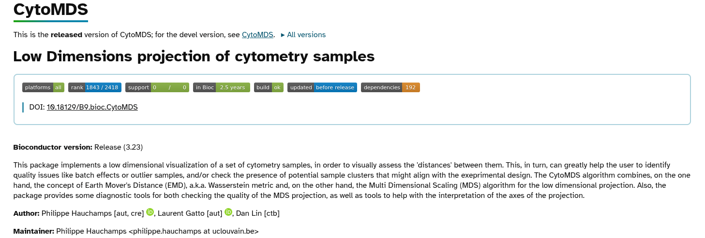

-  [Home]()
-  [Vignettes](https://www.bioconductor.org/packages/3.23/bioc/vignettes/CytoMDS/inst/doc/CytoMDS.html)
-  [GitHub](https://github.com/UCLouvain-CBIO/CytoMDS/)
-  [Issues](https://github.com/UCLouvain-CBIO/CytoMDS/issues)
-  [R](https://github.com/UCLouvain-CBIO/CytoMDS/tree/main/R)
-  [tests](https://github.com/UCLouvain-CBIO/CytoMDS/tree/main/tests/testthat)
-  [Build]()

### cytoMEM

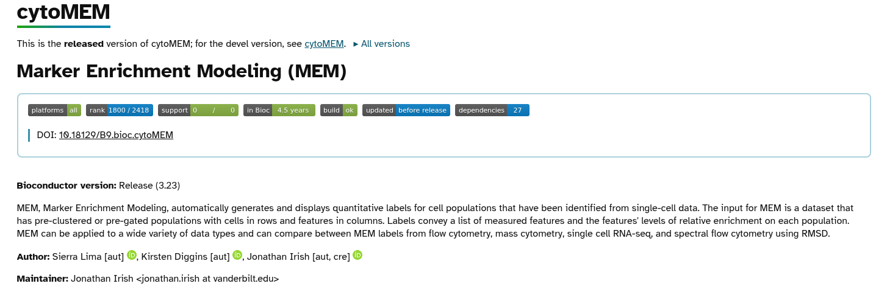

-  [Home]()
-  [Vignettes](https://www.bioconductor.org/packages/3.23/bioc/vignettes/cytoMEM/inst/doc/Intro_to_Marker_Enrichment_Modeling_Analysis.html)
-  [GitHub](https://github.com/cytolab/cytoMEM)
-  [Issues](https://github.com/cytolab/cytoMEM/issues)
-  [R]()
-  [tests]()
-  [Build]()

### CytoML

-  [Home]()
-  [Vignettes 1](https://www.bioconductor.org/packages/3.23/bioc/vignettes/CytoML/inst/doc/HowToExportGatingSet.html)
-  [Vignettes 2](https://www.bioconductor.org/packages/3.23/bioc/vignettes/CytoML/inst/doc/flowjo_to_gatingset.html)
-  [Vignettes 3](https://www.bioconductor.org/packages/3.23/bioc/vignettes/CytoML/inst/doc/cytobank2GatingSet.html)
-  [GitHub](https://github.com/RGLab/CytoML)
-  [Issues](https://github.com/RGLab/CytoML/issues)
-  [R](https://github.com/RGLab/CytoML/tree/devel/R)
-  [tests](https://github.com/RGLab/CytoML/tree/devel/tests/testthat)
-  [Build]()

### CytoPipeline

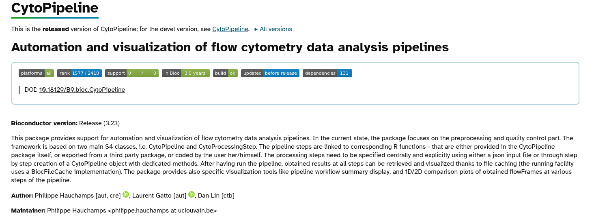

-  [Home]()
-  [Vignettes 1](https://www.bioconductor.org/packages/3.23/bioc/vignettes/CytoPipeline/inst/doc/CytoPipeline.html)
-  [Vignettes 2](https://www.bioconductor.org/packages/3.23/bioc/vignettes/CytoPipeline/inst/doc/Demo.html)
-  [GitHub](https://github.com/UCLouvain-CBIO/CytoPipeline/)
-  [Issues](https://github.com/UCLouvain-CBIO/CytoPipeline/issues)
-  [R](https://github.com/UCLouvain-CBIO/CytoPipeline/tree/main/R)
-  [tests](https://github.com/UCLouvain-CBIO/CytoPipeline/tree/main/tests/testthat)
-  [Build]()

### CytoPipelineGUI

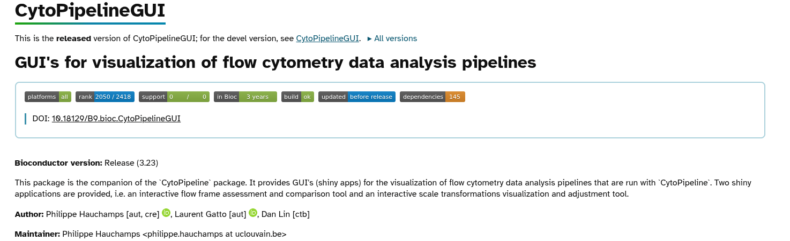

-  [Home]()
-  [Vignettes 1](https://www.bioconductor.org/packages/3.23/bioc/vignettes/CytoPipelineGUI/inst/doc/CytoPipelineGUI.html)
-  [Vignettes 2](https://www.bioconductor.org/packages/3.23/bioc/vignettes/CytoPipelineGUI/inst/doc/Demo.html)
-  [GitHub](https://github.com/UCLouvain-CBIO/CytoPipelineGUI/)
-  [Issues](https://github.com/UCLouvain-CBIO/CytoPipelineGUI/issues)
-  [R](https://github.com/UCLouvain-CBIO/CytoPipelineGUI/tree/main/R)
-  [tests](https://github.com/UCLouvain-CBIO/CytoPipelineGUI/tree/main/tests/testthat)
-  [Build]()

### DepecheR

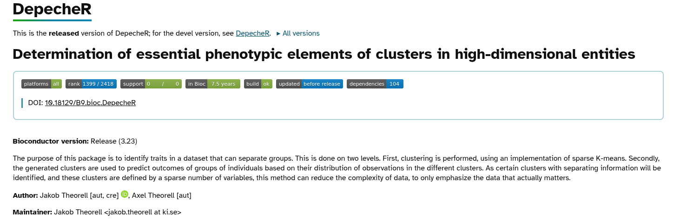

-  [Home]()
-  [Vignettes 1](https://www.bioconductor.org/packages/3.23/bioc/vignettes/DepecheR/inst/doc/DepecheR_test.html)
-  [Vignettes 2](https://www.bioconductor.org/packages/3.23/bioc/vignettes/DepecheR/inst/doc/GroupProbPlot_usage.html)
-  [GitHub]()
-  [Issues]()
-  [R]()
-  [tests]()
-  [Build]()

### diffcyt

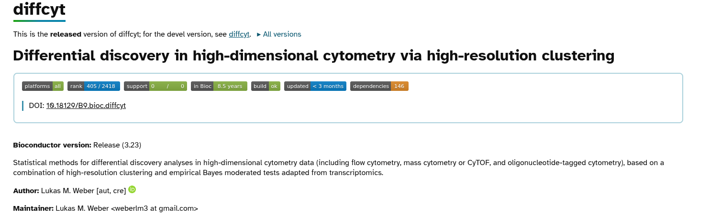

-  [Home]()
-  [Vignettes](https://www.bioconductor.org/packages/3.23/bioc/vignettes/diffcyt/inst/doc/diffcyt_workflow.html)
-  [GitHub](https://github.com/lmweber/diffcyt)
-  [Issues](https://github.com/lmweber/diffcyt/issues)
-  [R](https://github.com/lmweber/diffcyt/tree/devel/R)
-  [tests](https://github.com/lmweber/diffcyt/tree/devel/tests/testthat)
-  [Build]()

### distinct

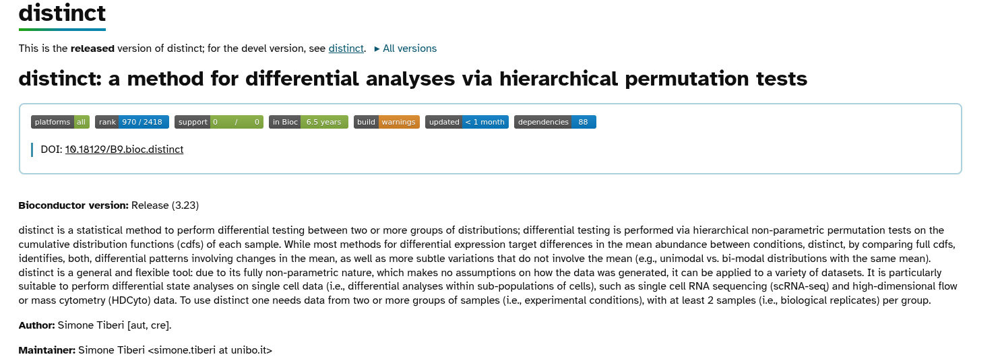

-  [Home]()
-  [Vignettes](https://www.bioconductor.org/packages/3.23/bioc/vignettes/distinct/inst/doc/distinct.html)
-  [GitHub](https://github.com/SimoneTiberi/distinct)
-  [Issues](https://github.com/SimoneTiberi/distinct/issues)
-  [R](https://github.com/SimoneTiberi/distinct/tree/master/R)
-  [tests](https://github.com/SimoneTiberi/distinct/tree/master/tests/testthat)
-  [Build]()

### flowAI

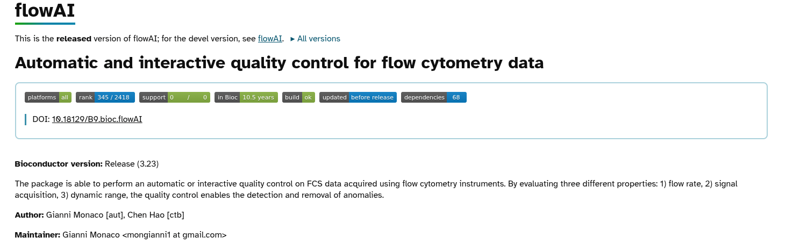

-  [Home]()
-  [Vignettes](https://www.bioconductor.org/packages/3.23/bioc/vignettes/flowAI/inst/doc/flowAI.html)
-  [Issues]()
-  [R]()
-  [tests]()
-  [Build]()

### flowBeads

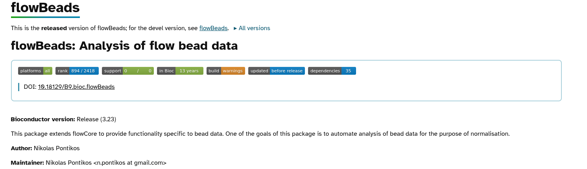

-  [Home]()
-  [Vignettes](https://www.bioconductor.org/packages/3.23/bioc/vignettes/flowBeads/inst/doc/HowTo-flowBeads.pdf)
-  [Issues]()
-  [R]()
-  [tests]()
-  [Build]()

### flowBin

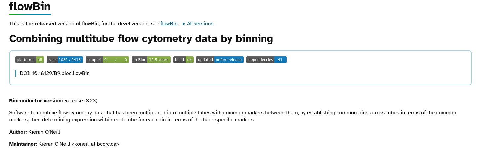

-  [Home]()
-  [Vignettes](https://www.bioconductor.org/packages/3.23/bioc/vignettes/flowBin/inst/doc/flowBin.pdf)
-  [Issues]()
-  [R]()
-  [tests]()
-  [Build]()

### flowCHIC

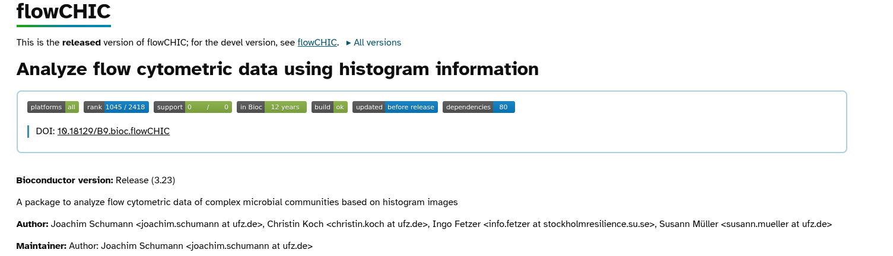

-  [Home]()
-  [Vignettes](https://www.bioconductor.org/packages/3.23/bioc/vignettes/flowCHIC/inst/doc/flowCHICmanual.pdf)
-  [Issues]()
-  [R]()
-  [tests]()
-  [Build]()

### flowClean
 
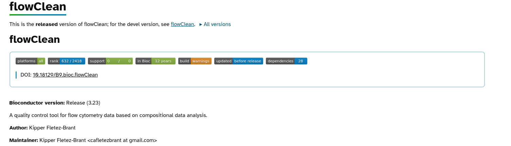

-  [Home]()
-  [Vignettes](https://www.bioconductor.org/packages/3.23/bioc/vignettes/flowClean/inst/doc/flowClean.pdf)
-  [Issues]()
-  [R]()
-  [tests]()
-  [Build]()

### flowClust

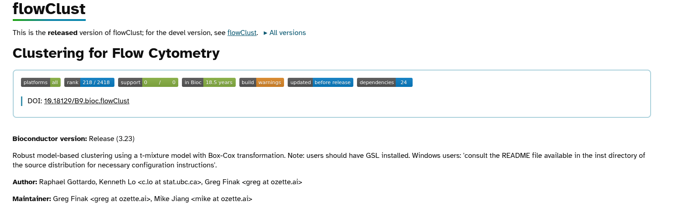

-  [Home]()
-  [Vignettes](https://www.bioconductor.org/packages/3.23/bioc/vignettes/flowClust/inst/doc/flowClust.html)
-  [Issues]()
-  [R]()
-  [tests]()
-  [Build]()

### flowCore

-  [Home]()
-  [Vignettes](https://www.bioconductor.org/packages/3.23/bioc/vignettes/flowCore/inst/doc/HowTo-flowCore.pdf)
-  [Issues]()
-  [R]()
-  [tests]()
-  [Build]()

### flowCut

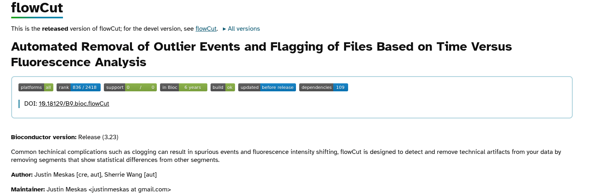

-  [Home]()
-  [Vignettes](https://www.bioconductor.org/packages/3.23/bioc/vignettes/flowCut/inst/doc/flowCut.html)
-  [Issues]()
-  [R]()
-  [tests]()
-  [Build]()

### flowCyBar

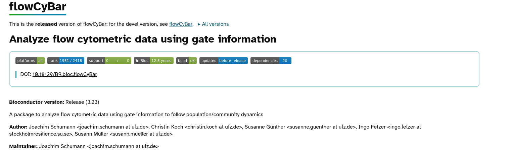

-  [Home]()
-  [Vignettes](https://www.bioconductor.org/packages/3.23/bioc/vignettes/flowCyBar/inst/doc/flowCyBar-manual.pdf)
-  [Issues]()
-  [R]()
-  [tests]()
-  [Build]()

### flowDensity

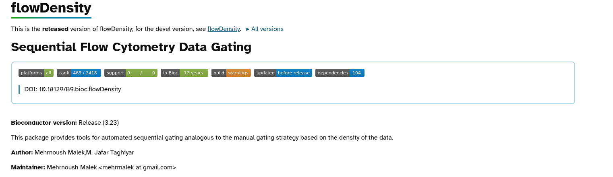

-  [Home]()
-  [Vignettes]() None
-  [Issues]()
-  [R]()
-  [tests]()
-  [Build]()

### flowFP

-  [Home]()
-  [Vignettes](https://www.bioconductor.org/packages/3.23/bioc/vignettes/flowFP/inst/doc/flowFP_HowTo.pdf)
-  [Issues]()
-  [R]()
-  [tests]()
-  [Build]()

### flowGate

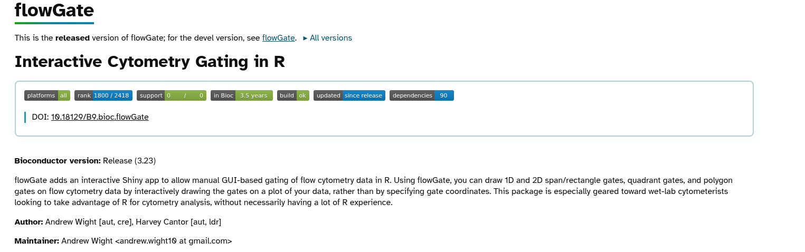

-  [Home]()
-  [Vignettes](https://www.bioconductor.org/packages/3.23/bioc/vignettes/flowGate/inst/doc/flowGate.html)
-  [Issues]()
-  [R]()
-  [tests]()
-  [Build]()

### flowGraph

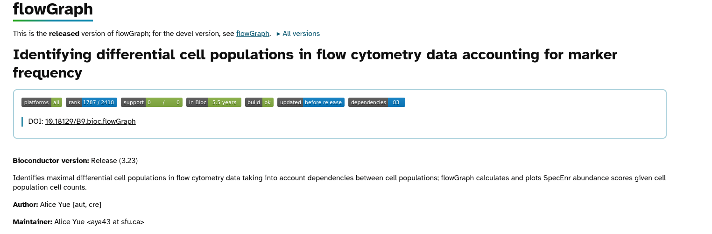

-  [Home]()
-  [Vignettes](https://www.bioconductor.org/packages/3.23/bioc/vignettes/flowGraph/inst/doc/flowGraph.html)
-  [GitHub](https://github.com/aya49/flowGraph)
-  [Issues](https://github.com/aya49/flowGraph/issues)
-  [R](https://github.com/aya49/flowGraph/tree/master/R)
-  [tests](https://github.com/aya49/flowGraph/tree/master/tests/testthat)
-  [Build]()

### flowMatch
 
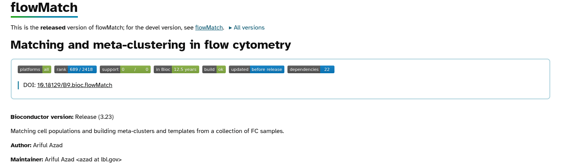

-  [Home]()
-  [Vignettes](https://www.bioconductor.org/packages/3.23/bioc/vignettes/flowMatch/inst/doc/flowMatch.pdf)
-  [Issues]()
-  [R]()
-  [tests]()
-  [Build]()

### flowMeans

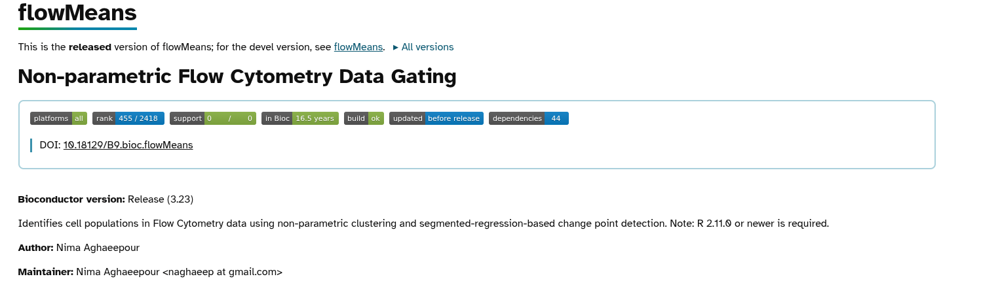

-  [Home]()
-  [Vignettes](https://www.bioconductor.org/packages/3.23/bioc/vignettes/flowMeans/inst/doc/flowMeans.pdf)
-  [Issues]()
-  [R]()
-  [tests]()
-  [Build]()

### flowMerge

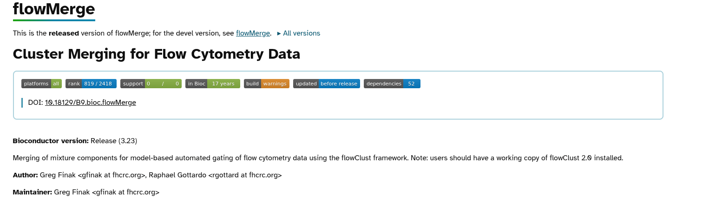

-  [Home]()
-  [Vignettes](https://www.bioconductor.org/packages/3.23/bioc/vignettes/flowMerge/inst/doc/flowmerge.html)
-  [Issues]()
-  [R]()
-  [tests]()
-  [Build]()

### flowPeaks

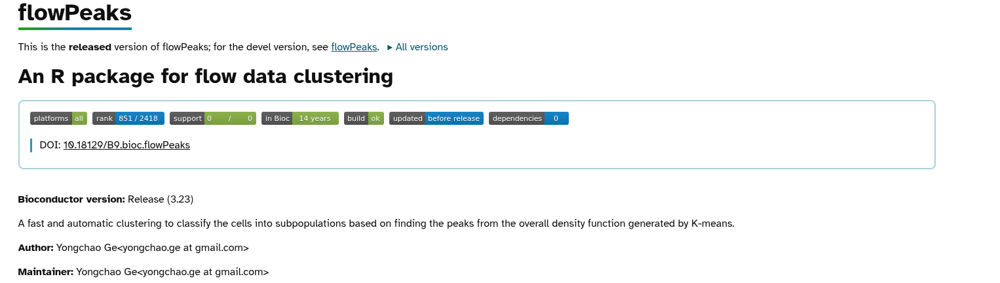

-  [Home]()
-  [Vignettes](https://www.bioconductor.org/packages/3.23/bioc/vignettes/flowPeaks/inst/doc/flowPeaks-guide.pdf)
-  [Issues]()
-  [R]()
-  [tests]()
-  [Build]()

### flowPloidy

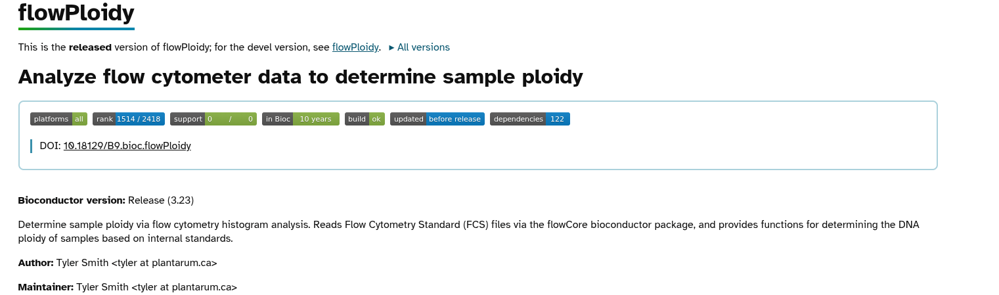

-  [Home]()
-  [Vignettes](https://www.bioconductor.org/packages/3.23/bioc/vignettes/flowPloidy/inst/doc/flowPloidy-gettingStarted.pdf)
-  [Vignettes](https://www.bioconductor.org/packages/3.23/bioc/vignettes/flowPloidy/inst/doc/histogram-tour.pdf)
-  [GitHub](https://github.com/plantarum/flowPloidy)
-  [Issues](https://github.com/plantarum/flowPloidy/issues)
-  [R](https://github.com/plantarum/flowPloidy/tree/master/R)
-  [tests](https://github.com/plantarum/flowPloidy/tree/master/tests/testthat)
-  [Build]()

### flowPlots

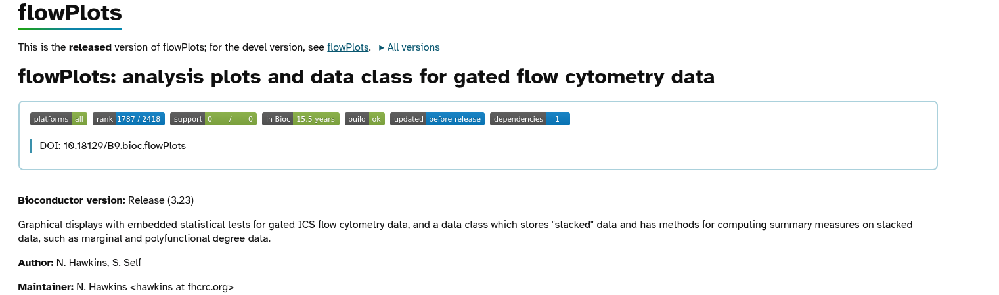

-  [Home]()
-  [Vignettes](https://www.bioconductor.org/packages/3.23/bioc/vignettes/flowPlots/inst/doc/flowPlots.pdf)
-  [Issues]()
-  [R]()
-  [tests]()
-  [Build]()

### FlowSOM

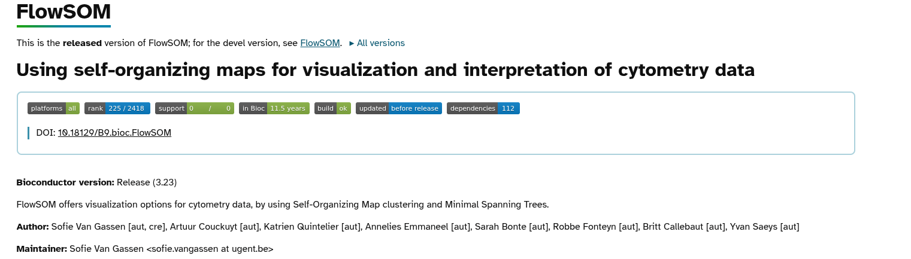

-  [Home]()
-  [Vignettes](https://www.bioconductor.org/packages/3.23/bioc/vignettes/FlowSOM/inst/doc/FlowSOM.pdf)
-  [Issues]()
-  [R]()
-  [tests]()
-  [Build]()

### flowSpecs
 
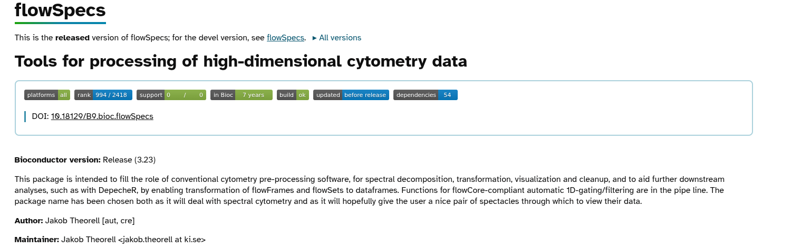

-  [Home]()
-  [Vignettes](https://www.bioconductor.org/packages/3.23/bioc/vignettes/flowSpecs/inst/doc/flowSpecs_vinjette.html)
-  [Issues](https://github.com/jtheorell/flowSpecs/issues)
-  [R](https://github.com/jtheorell/flowSpecs/tree/master/R)
-  [tests](https://github.com/jtheorell/flowSpecs/tree/master/tests/testthat)
-  [Build]()

### flowStats

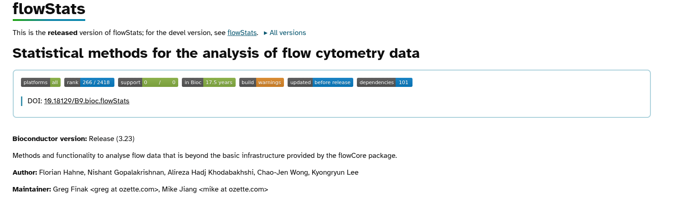

-  [Home]()
-  [Vignettes](https://www.bioconductor.org/packages/3.23/bioc/vignettes/flowStats/inst/doc/GettingStartedWithFlowStats.pdf)
-  [Issues](https://github.com/RGLab/flowStats/issues)
-  [R](https://github.com/RGLab/flowStats/tree/devel/R)
-  [tests](https://github.com/RGLab/flowStats/tree/devel/tests/testthat)
-  [Build]()

### flowTime

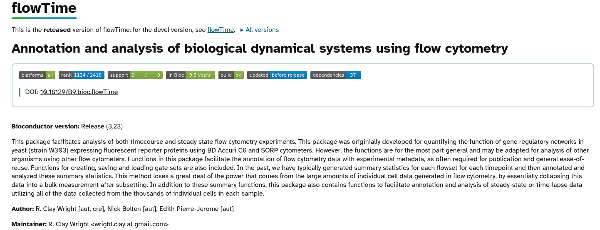

-  [Home]()
-  [Vignettes](https://www.bioconductor.org/packages/3.23/bioc/vignettes/flowTime/inst/doc/gating-vignette.html)
-  [Vignettes](https://www.bioconductor.org/packages/3.23/bioc/vignettes/flowTime/inst/doc/steady-state-vignette.html)
-  [Vignettes](https://www.bioconductor.org/packages/3.23/bioc/vignettes/flowTime/inst/doc/time-course-vignette.html)
-  [Issues]()
-  [R]()
-  [tests]()
-  [Build]()

### flowTrans

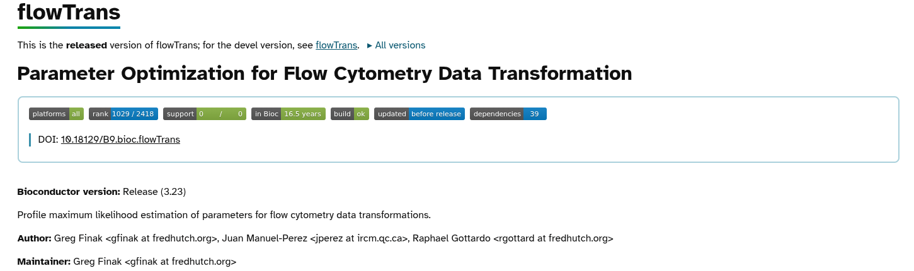

-  [Home]()
-  [Vignettes](https://www.bioconductor.org/packages/3.23/bioc/vignettes/flowTrans/inst/doc/flowTrans.pdf)
-  [Issues]()
-  [R]()
-  [tests]()
-  [Build]()

### flowViz

-  [Home]()
-  [Vignettes](https://www.bioconductor.org/packages/3.23/bioc/vignettes/flowViz/inst/doc/filters.html)
-  [Issues]()
-  [R]()
-  [tests]()
-  [Build]()

### flowVS

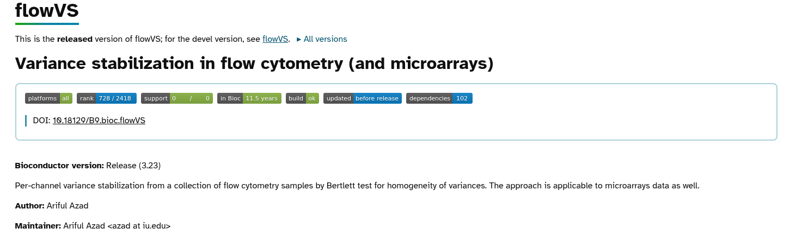

-  [Home]()
-  [Vignettes](https://www.bioconductor.org/packages/3.23/bioc/vignettes/flowVS/inst/doc/flowVS.pdf)
-  [Issues]()
-  [R]()
-  [tests]()
-  [Build]()

### flowWorkspace

-  [Home]()
-  [Vignettes](https://www.bioconductor.org/packages/3.23/bioc/vignettes/flowWorkspace/inst/doc/flowWorkspace-Introduction.html)
-  [Vignettes](https://www.bioconductor.org/packages/3.23/bioc/vignettes/flowWorkspace/inst/doc/HowToMergeGatingSet.html)
-  [Issues]()
-  [R]()
-  [tests]()
-  [Build]()

### GateFinder

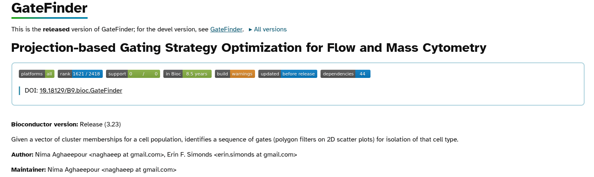

-  [Home]()
-  [Vignettes](https://www.bioconductor.org/packages/3.23/bioc/vignettes/GateFinder/inst/doc/GateFinder.pdf)
-  [GitHub]()
-  [Issues]()
-  [R]()
-  [tests]()
-  [Build]()

### ggcyto

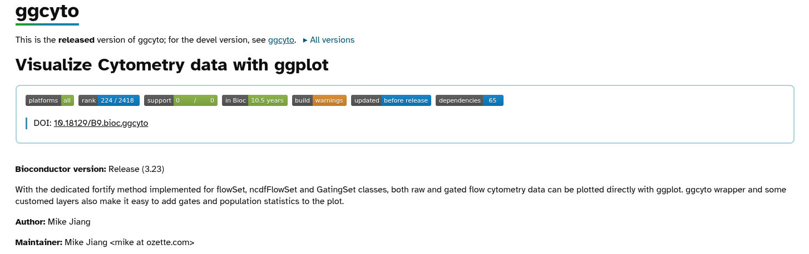

-  [Home]()
-  [Vignettes](https://www.bioconductor.org/packages/3.23/bioc/vignettes/ggcyto/inst/doc/autoplot.html)
-  [Vignettes](https://www.bioconductor.org/packages/3.23/bioc/vignettes/ggcyto/inst/doc/ggcyto.flowSet.html)
-  [Vignettes](https://www.bioconductor.org/packages/3.23/bioc/vignettes/ggcyto/inst/doc/ggcyto.GatingSet.html)
-  [Vignettes](https://www.bioconductor.org/packages/3.23/bioc/vignettes/ggcyto/inst/doc/Top_features_of_ggcyto.html)
-  [GitHub](https://github.com/RGLab/ggcyto)
-  [Issues](https://github.com/RGLab/ggcyto/issues)
-  [R](https://github.com/RGLab/ggcyto/tree/devel/R)
-  [tests](https://github.com/RGLab/ggcyto/tree/devel/tests/testthat)
-  [Build]()

### immunoClust

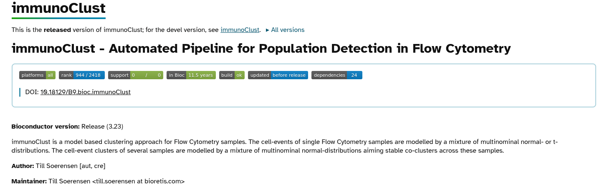

-  [Home]()
-  [Vignettes](https://www.bioconductor.org/packages/3.23/bioc/vignettes/immunoClust/inst/doc/immunoClust.pdf)
-  [Issues]()
-  [R]()
-  [tests]()
-  [Build]()

### infinityFlow

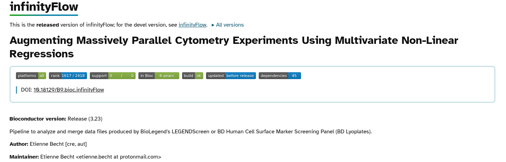

-  [Home]()
-  [Vignettes](https://www.bioconductor.org/packages/3.23/bioc/vignettes/infinityFlow/inst/doc/basic_usage.html)
-  [Vignettes](https://www.bioconductor.org/packages/3.23/bioc/vignettes/infinityFlow/inst/doc/training_non_default_regression_models.html)
-  [Issues]()
-  [R]()
-  [tests]()
-  [Build]()

### MACSQuantifyR

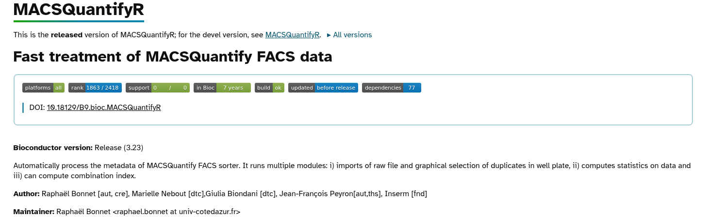

-  [Home]()
-  [Vignettes](https://www.bioconductor.org/packages/3.23/bioc/vignettes/MACSQuantifyR/inst/doc/MACSQuantifyR_combo.html)
-  [Vignettes](https://www.bioconductor.org/packages/3.23/bioc/vignettes/MACSQuantifyR/inst/doc/MACSQuantifyR_pipeline.html)
-  [Vignettes](https://www.bioconductor.org/packages/3.23/bioc/vignettes/MACSQuantifyR/inst/doc/MACSQuantifyR.html)
-  [Issues]()
-  [R]()
-  [tests]()
-  [Build]()

### MAPFX

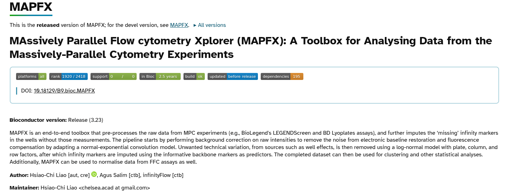

-  [Home]()
-  [Vignettes](https://www.bioconductor.org/packages/3.23/bioc/vignettes/MAPFX/inst/doc/MAPFX_Vignette.html)
-  [GitHub](https://github.com/HsiaoChiLiao/MAPFX)
-  [Issues](https://github.com/HsiaoChiLiao/MAPFX/issues)
-  [R](https://github.com/HsiaoChiLiao/MAPFX/tree/main/R)
-  [tests](https://github.com/HsiaoChiLiao/MAPFX/tree/main/tests/testthat)
-  [Build]()

### MDSvis

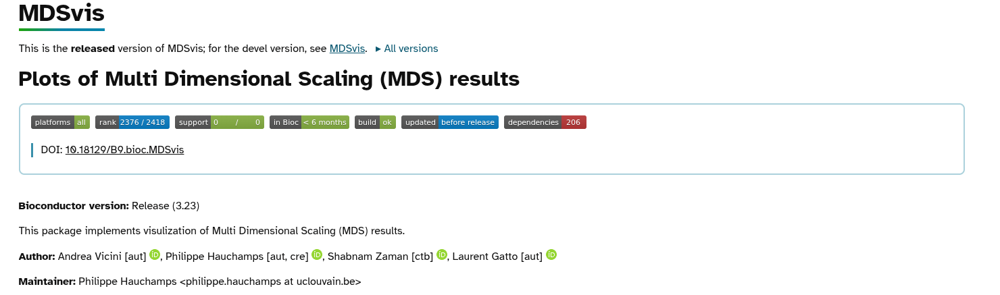

-  [Home]()
-  [Vignettes](https://www.bioconductor.org/packages/3.23/bioc/vignettes/MDSvis/inst/doc/MDSvis_Input_From_Distance.html)
-  [Vignettes](https://www.bioconductor.org/packages/3.23/bioc/vignettes/MDSvis/inst/doc/MDSvis.html)
-  [GitHub](https://github.com/UCLouvain-CBIO/MDSvis/)
-  [Issues](https://github.com/UCLouvain-CBIO/MDSvis/issues)
-  [R](https://github.com/UCLouvain-CBIO/MDSvis/tree/main/R)
-  [tests](https://github.com/UCLouvain-CBIO/MDSvis/tree/main/tests/testthat)
-  [Build]()

### MetaCyto

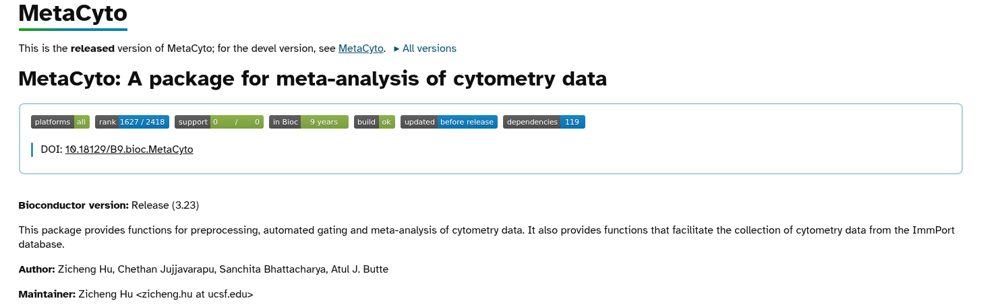

-  [Home]()
-  [Vignettes](https://www.bioconductor.org/packages/3.23/bioc/vignettes/MetaCyto/inst/doc/MetaCyto_Vignette.html)
-  [Issues]()
-  [R]()
-  [tests]()
-  [Build]()

### ncdfFlow

-  [Home]()
-  [Vignettes](https://www.bioconductor.org/packages/3.23/bioc/vignettes/ncdfFlow/inst/doc/ncdfFlow.pdf)
-  [Issues]()
-  [R]()
-  [tests]()
-  [Build]()

### openCyto

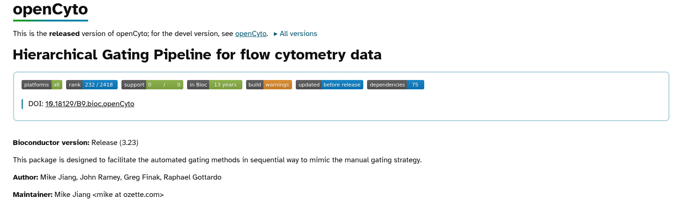

-  [Home]()
-  [Vignettes](https://www.bioconductor.org/packages/3.23/bioc/vignettes/openCyto/inst/doc/HowToAutoGating.html)
-  [Vignettes](https://www.bioconductor.org/packages/3.23/bioc/vignettes/openCyto/inst/doc/HowToWriteCSVTemplate.html)
-  [Vignettes](https://www.bioconductor.org/packages/3.23/bioc/vignettes/openCyto/inst/doc/openCytoVignette.html)
-  [Issues]()
-  [R]()
-  [tests]()
-  [Build]()

### optimalFlow

-  [Home]()
-  [Vignettes](https://www.bioconductor.org/packages/3.23/bioc/html/optimalFlow.html)
-  [Issues]()
-  [R]()
-  [tests]()
-  [Build]()

### PeacoQC

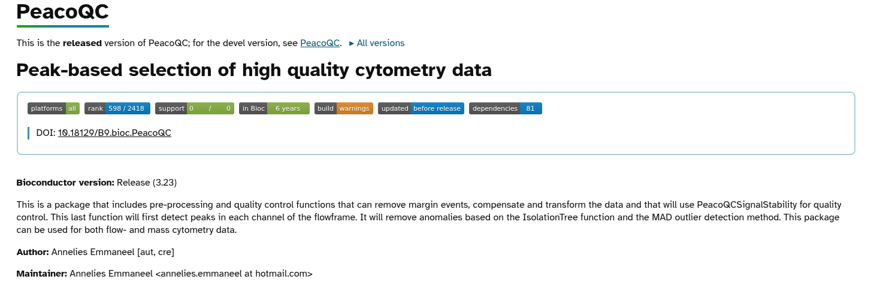

-  [Home]()
-  [Vignettes](https://www.bioconductor.org/packages/3.23/bioc/vignettes/PeacoQC/inst/doc/PeacoQC_Vignette.pdf)
-  [GitHub](https://github.com/saeyslab/PeacoQC)
-  [Issues](https://github.com/saeyslab/PeacoQC/issues)
-  [R](https://github.com/saeyslab/PeacoQC/tree/master/R)
-  [tests]()
-  [Build]()

### plotGrouper

-  [Home]()
-  [Vignettes](https://www.bioconductor.org/packages/3.23/bioc/vignettes/plotGrouper/inst/doc/plotGrouper-vignette.html)
-  [GitHub](https://github.com/jdgagnon/plotGrouper)
-  [Issues](https://github.com/jdgagnon/plotGrouper/issues)
-  [R](https://github.com/jdgagnon/plotGrouper/tree/master/R)
-  [tests](https://github.com/jdgagnon/plotGrouper/tree/master/tests/testthat)
-  [Build]()

### quantiseqr

-  [Home]()
-  [Vignettes](https://www.bioconductor.org/packages/3.23/bioc/vignettes/quantiseqr/inst/doc/using_quantiseqr.html)
-  [Issues]()
-  [R]()
-  [tests]()
-  [Build]()

### reconsi

-  [Home]()
-  [Vignettes](https://www.bioconductor.org/packages/3.23/bioc/vignettes/reconsi/inst/doc/reconsiVignette.html)
-  [GitHub](https://github.com/CenterForStatistics-UGent/reconsi)
-  [Issues](https://github.com/CenterForStatistics-UGent/reconsi/issues)
-  [R](https://github.com/CenterForStatistics-UGent/reconsi/tree/master/R)
-  [tests](https://github.com/CenterForStatistics-UGent/reconsi/tree/master/tests/testthat)
-  [Build]()

### sccomp

-  [Home]()
-  [Vignettes](https://www.bioconductor.org/packages/3.23/bioc/vignettes/sccomp/inst/doc/introduction.html)
-  [GitHub](https://github.com/MangiolaLaboratory/sccomp)
-  [Issues](https://github.com/MangiolaLaboratory/sccomp/issues)
-  [R](https://github.com/MangiolaLaboratory/sccomp/tree/master/R)
-  [tests](https://github.com/MangiolaLaboratory/sccomp/tree/master/tests/testthat)
-  [Build]()

### scDataviz

-  [Home]()
-  [Vignettes](https://www.bioconductor.org/packages/3.23/bioc/vignettes/scDataviz/inst/doc/scDataviz.html)
-  [GitHub](https://github.com/kevinblighe/scDataviz)
-  [Issues](https://github.com/kevinblighe/scDataviz/issues)
-  [R](https://github.com/kevinblighe/scDataviz/tree/master/R)
-  [tests](https://github.com/kevinblighe/scDataviz/tree/master/tests)
-  [Build]()

### scifer

-  [Home]()
-  [Vignettes](https://www.bioconductor.org/packages/3.23/bioc/vignettes/scifer/inst/doc/scifer_walkthrough.html)
-  [GitHub](https://github.com/rodrigarc/scifer)
-  [Issues](https://github.com/rodrigarc/scifer/issues)
-  [R](https://github.com/rodrigarc/scifer/tree/master/R)
-  [tests](https://github.com/rodrigarc/scifer/tree/master/tests/testthat)
-  [Build]()

### Sconify

-  [Home]()
-  [Vignettes](https://www.bioconductor.org/packages/3.23/bioc/vignettes/Sconify/inst/doc/DataQuality.html)
-  [Vignettes](https://www.bioconductor.org/packages/3.23/bioc/vignettes/Sconify/inst/doc/FindingIdealK.html)
-  [Vignettes](https://www.bioconductor.org/packages/3.23/bioc/vignettes/Sconify/inst/doc/Step1.PreProcessing.html)
-  [Vignettes](https://www.bioconductor.org/packages/3.23/bioc/vignettes/Sconify/inst/doc/Step2.TheSconeWorkflow.html)
-  [Vignettes](https://www.bioconductor.org/packages/3.23/bioc/vignettes/Sconify/inst/doc/Step3.PostProcessing.html)
-  [Issues]()
-  [R]()
-  [tests]()
-  [Build]()

### spillR

-  [Home]()
-  [Vignettes](https://www.bioconductor.org/packages/3.23/bioc/vignettes/spillR/inst/doc/spillR-vignette.html)
-  [Issues]()
-  [R]()
-  [tests]()
-  [Build]()

### staRgate

-  [Home]()
-  [Vignettes](https://www.bioconductor.org/packages/3.23/bioc/vignettes/staRgate/inst/doc/vignette_run_pipeline.html)
-  [GitHub](https://github.com/leejasme/staRgate)
-  [Issues](https://github.com/leejasme/staRgate/issues)
-  [R](https://github.com/leejasme/staRgate/tree/main/R)
-  [tests](https://github.com/leejasme/staRgate/tree/main/tests/testthat)
-  [Build]()

### SuperCellCyto

-  [Home]()
-  [Vignettes](https://www.bioconductor.org/packages/3.23/bioc/vignettes/SuperCellCyto/inst/doc/how_to_prepare_data.html)
-  [Vignettes](https://www.bioconductor.org/packages/3.23/bioc/vignettes/SuperCellCyto/inst/doc/interoperability_with_sce.html)
-  [Vignettes](https://www.bioconductor.org/packages/3.23/bioc/vignettes/SuperCellCyto/inst/doc/interoperability_with_seurat.html)
-  [Vignettes](https://www.bioconductor.org/packages/3.23/bioc/vignettes/SuperCellCyto/inst/doc/SuperCellCyto.html)
-  [Vignettes](https://www.bioconductor.org/packages/3.23/bioc/vignettes/SuperCellCyto/inst/doc/using_supercellcyto_for_stratified_summarising.html)
-  [GitHub](https://github.com/phipsonlab/SuperCellCyto/)
-  [Issues](https://github.com/phipsonlab/SuperCellCyto/issues)
-  [R](https://github.com/phipsonlab/SuperCellCyto/tree/main/R)
-  [tests](https://github.com/phipsonlab/SuperCellCyto/tree/main/tests/testthat)
-  [Build]()

### tidyFlowCore

-  [Home]()
-  [Vignettes](https://www.bioconductor.org/packages/3.23/bioc/vignettes/tidyFlowCore/inst/doc/tidyFlowCore.html)
-  [GitHub](https://github.com/keyes-timothy/tidyFlowCore)
-  [Issues](https://github.com/keyes-timothy/tidyFlowCore/issues)
-  [R](https://github.com/keyes-timothy/tidyFlowCore/tree/main/R)
-  [tests](https://github.com/keyes-timothy/tidyFlowCore/tree/main/tests/testthat)
-  [Build]()

### tidytof

-  [Home]()
-  [Vignettes]()
-  [GitHub](https://github.com/keyes-timothy/tidytof)
-  [Issues](https://github.com/keyes-timothy/tidytof/issues)
-  [R](https://github.com/keyes-timothy/tidytof/tree/main/R)
-  [tests](https://github.com/keyes-timothy/tidytof/tree/main/tests)
-  [Build]()

### treekoR

-  [Home]()
-  [Vignettes](https://www.bioconductor.org/packages/3.23/bioc/vignettes/treekoR/inst/doc/vignette.html)
-  [Issues]()
-  [R]()
-  [tests]()
-  [Build]()

[![AGPL-3.0][agpl3-image]][agpl3]
[![CC BY-SA 4.0][cc-by-sa-image]][cc-by-sa]

[cc-by-sa]: http://creativecommons.org/licenses/by-sa/4.0/
[cc-by-sa-image]: https://licensebuttons.net/l/by-sa/4.0/88x31.png
[cc-by-sa-shield]: https://img.shields.io/badge/License-CC%20BY--SA%204.0-lightgrey.svg
[agpl3]: https://www.gnu.org/licenses/agpl-3.0.en.html
[agpl3-image]: https://www.gnu.org/graphics/agplv3-with-text-162x68.png
[agpl3-shield]: https://img.shields.io/badge/license-AGPLv3-blue

