::: {style="text-align: right;"}
[](https://www.gnu.org/licenses/agpl-3.0.en.html) [](http://creativecommons.org/licenses/by-sa/4.0/)
:::

For the YouTube livestream recording, see [here](https://www.youtube.com/live/X4UfexxPb-Y?si=xQ7DgyFzYCR-kxHV&t=264)

<iframe width="560" height="315" src="https://www.youtube.com/embed/X4UfexxPb-Y?si=xQ7DgyFzYCR-kxHV&amp;start=264" title="YouTube video player" frameborder="0" allow="accelerometer; autoplay; clipboard-write; encrypted-media; gyroscope; picture-in-picture; web-share" referrerpolicy="strict-origin-when-cross-origin" allowfullscreen></iframe>

For screen-shot slides, click [here](/course/15_EvaluatingUnmixing/slides.qmd)

<br>

---

# Background

Welcome back! Previously, as part of the [Week 14](/course/14_Unmixing/index.qmd) walk-through, we systematically worked out how to unmixing in R using [ordinary least squares](https://en.wikipedia.org/wiki/Ordinary_least_squares)(OLS). To accomplish this, we needed to provide our raw full-stained .fcs files, as well as a matrix of normalized fluorescent signatures extracted from our unmixing controls (derived as part of the [Signature Matrices](/course/SDY3080/SignatureMatrices.qmd) walk-through). With these inputs provided, during unmixing, we were able to estimate based on the total signal of an individual cell whether a fluorophore was present, and if so, what its relative abundance was. At that point, we just needed to ensure that the raw .fcs file [formatting](/course/14_Unmixing/unmixing.qmd) was updated to reflect that which is typical of an unmixed .fcs file. 

While having suceeded in returning unmixed .fcs files, a crucial step in the typical spectral flow cytometrist workflow is missing. We didn't examine the final unmixed fcs files for the presence of unmixing errors. This process is typically carried out by visually screening 1xN or NxN plots, with unmixing erorrs typically appearing as tilts, blebs or skews.  If we found these, this would be indicative that at least one of the signatures in the reference matrix didn't match the actual fluorescent signatures as present in the full-stained sample. To simplify our overall workflow, during the [Luciernaga](/course/SDY3080/LuciernagaIntegration.qmd) walk-through, we screened our unmixing controls (both single-color and unstained) and identified several that might have the potential to be problematic due to tandem degradation and autofluorescence residuals. 

As we wrap up the Spectral Cytometry section, and enter the Unsupervised section, a point I would like to emphasize is just because we do something in R (whether unmixing with OLS or a newer unmixing algorithm) doesn't mean that we are exempt from following community best practices. Indeed, these guidelines take on added importance, as unmixing errors can wreck havoc on unsupervised analysis algorithms that rely on consistent MFI to distinguish what is positive or negative for a given marker. 

In today's walkthrough, we will learn how to implement our regular screening workflow in an R context. Additionally, unmixing in R comes with an added advantage. We can easily set up iteration, allowing us to keep everything else exactly the same, but swap in signature variants for one fluorophore, visualizing the variant .fcs files to make informed decisions, and allow us to gain additional familiarity about how unmixing works generally. 


# Walk Through

:::{.callout-important title="Sync Your Fork!"}

If you haven't yet done so, please go to GitHub [sync](/course/00_Homeworks/index.qmd#sync-your-fork) your forked version of the CytometryInR course. This will provide you access to the code and data for this week's walkthrough. Once done, open Positron, and [pull](/course/00_Homeworks/index.qmd#pull-to-local) those changes locally to have everything on your local computer. If you prefer, you can watch the YouTube walk-through [here](https://www.youtube.com/live/Zfctacqpe90?si=a7Ad61kj6_UDNkGw&t=32).

To prevent merge issues when bringing in new data next time, remember to [set up](/course/00_Git/index.qmd#new-folder-from-template) a new project folder ("Week15" if you are following the course naming scheme), and copy over any files or data to that new project folder. Once everything is organized, remember to stage, [commit](/course/00_Git/index.qmd#push) and then push to GitHub to take advantage of version control and that your code is backed up. 

For any merge issues, see this [walkthrough](https://umgcccfcsr.github.io/CytometryInR/course/00_BonusContent/PullConflicts/). For those wishing to submit the completed homework problems, instructions can be found [here](https://umgcccfcsr.github.io/CytometryInR/course/00_BonusContent/PullConflicts/UpdatedPullRequest)
:::

:::{.callout-important title="New R Version"}

When opening Positron, you will likely be reminded that a new R version has rolled out. Bioconductor is similarly set to roll-out its new stable version of R packages at the end of November. If you want to get a head start and upgrade R now, and the Bioconductor packages later, feel free (I am choosing to wait until then and then just upgrade everything in one go).

:::

## Set Up

Before getting started, pleas make sure you have `Luciernaga` version 0.99.13 installed, as we will be using it extensively throughout todays walkthrough. 

```{r}
packageVersion("Luciernaga")

#| remotes::install_github("DavidRach/Luciernaga")
#| pak::pkg_install("DavidRach/Luciernaga")
```

We begin as always, attaching the various [R packages](/course/01_InstallingRPackages/) to our local environment that we will need throughout today.

```{r}
library(flowWorkspace)
library(Luciernaga)
library(dplyr)
library(purrr)
library(ggplot2)
```

Similarly, we will need to also load any functions that we wrote and stored in our "R" folder. This is particularly important given that our `OldFashionedUnmix()` function and its helpers that were created as part of [Week 14](/course/14_Unmixing/index.qmd) are being stored there. 

```{r}
# RFolder <- file.path("course", "15_EvaluatingUnmixing", "R")
  RFolder <- file.path("R") # For Quarto Rendering

MyFunctions <- list.files(RFolder, full.names=TRUE)
purrr::walk(.x=MyFunctions, .f=source)
```

Next up, lets designate the `file.path()` to the location of both our storage and output folders. 

```{r}
# StorageLocation <- file.path("course", "15_EvaluatingUnmixing", "data")
 StorageLocation <- file.path("data")

# OutputLocation <- file.path("course", "15_EvaluatingUnmixing", "outputs")
 OutputLocation <- file.path("outputs")
```

With the storage location of our files established, we can using `list.files()` identify the .fcs files that are present in the "data" folder. 

```{r}
fcs_files <- list.files(StorageLocation, pattern=".fcs", full.names=TRUE)
fcs_files
```

For this week's dataset, we are continuing to use the [SDY3080](/course/SDY3080/ImmPort.qmd) dataset. The .fcs files originate from two individuals (INF052, a cord blood specimen; and ND050, the adult PBMC batch/normalization control), under two conditions (PMA-ionomyicin activated, and control/baseline). All were processed and stained on the same day, before being acquired the following day.

Having located the raw full-stained .fcs files location, we need to also provide the [reference matrices](/course/SDY3080/SignatureMatrices.qmd) for both cell and bead unmixing controls. However, we also want to have access to the [signature variants](/course/SDY3080/LuciernagaIntegration.qmd) isolated via `Luciernaga` to allow us to swap these in and see how it impacts the overall unmixing. These were all saved out as .csv's as part of the previous walkthoughs, and can also be found in the "data" folder.

```{r}
csv_files <- list.files(StorageLocation, pattern=".csv", full.names=TRUE)
csv_files
```

For now, lets plan to use signatures derrived from just our cell single-color controls, saving the bead signatures for another day.  Lets go ahead and load that .csv

```{r}
AllCellControlSignatures <- csv_files[stringr::str_detect(csv_files, "CellsUpdatedSignatureMatrix")]
CellSignatures <- read.csv(AllCellControlSignatures, check.names=FALSE)
CellSignatures <- CellSignatures |> select(-c(name, Type, Detector, Negative))
```

Likewise, lets add a single autofluorescence signature to the matrix. We will use the main "Average" autofluorescence for the "ND006 Ctrl" specimen for now. 

```{r}
ND006CtrlSignatures <- csv_files[stringr::str_detect(csv_files, "ND006Ctrl")]
ND006Ctrl <- read.csv(ND006CtrlSignatures, check.names=FALSE)
TheAutofluorescence <- ND006Ctrl |> filter(Cluster %in% "Average")
TheAutofluorescence <- TheAutofluorescence |>
     rename(Fluorophore = Cluster) |> mutate(Fluorophore="AF") |>
      mutate(Antigen="Unstained") |> relocate(Antigen, .after=Fluorophore)
```

With both .csv files now read in and present in our environment as `data.frame` objects, lets combine them using `bind_rows()`

```{r}
AssembledSignatures <- bind_rows(CellSignatures, TheAutofluorescence)
```

```{r}
tail(AssembledSignatures, 5) |> select(Fluorophore, Antigen,`UV1-A`)
```

And with that, we have now gathered the components needed for unmixing. 

## First Unmixing

Lets start assembling the basic infrastructure that we will need to generate our unmixed .fcs files, and then screen them as we would in a typical spectral flow cytometry workflow using 1xN plots. To try to keep things slightly-better organized, rather than send everything into the "outputs" folder, lets create subfolders as we go, and save different versions of our unmixings within them. This will also allow us to compare and contrast different unmixings later on as well when visualizing. 

```{r}
StashHere <- file.path(OutputLocation, "FirstAttempt")

if (!dir.exists(StashHere)){dir.create(StashHere)}
```

With the subfolder now in place, lets go ahead and carry out our first unmixing (29-fluorophore + 1 autofluorescent signature)

```{r}
#| eval: FALSE
walk(.x=fcs_files, .f=OldFashionedUnmix, 
    SignatureData=AssembledSignatures, returnType="fcs",
    outpath=StashHere)
```

Likewise, if we were curious about the [residuals](/course/14_Unmixing/index.qmd#residuals), we can swap out the 'returnType' argument.

```{r}
ResidualPlots <- map(.x=fcs_files, .f=OldFashionedUnmix, 
    SignatureData=AssembledSignatures, returnType="residuals")
```

```{r}
ResidualPlots[1]
```

Once the unmixed .fcs files have been created, its time to read them back in to R as a GatingSet, and then transform them

```{r}
TheseFCSFiles <- list.files(StashHere, pattern=".fcs", full.names=TRUE)
TheCytoset <- load_cytoset_from_fcs(TheseFCSFiles,
 truncate_max_range=FALSE, transformation=FALSE)
TheGatingSet <- GatingSet(TheCytoset)

SFC_Parameters <- colnames(TheGatingSet)
FluorophoresOnly <- SFC_Parameters[!stringr::str_detect(SFC_Parameters, "FSC|SSC|Time")]
Biexponential <-  flowjo_biexp_trans(channelRange=4096,
 maxValue=4194304, pos=5.62, neg=0, widthBasis=-1000)
MyBiexTransform <- transformerList(FluorophoresOnly, Biexponential)
transform(TheGatingSet, MyBiexTransform)
```

### Unity Plots

One of the `Luciernaga` visual plots we encountered previously was `Utility_UnityPlot()`. Unlike a 1 or NxN plot which focuses on a single individual looking at different markers, it visualizes across all individuals present in a GatingSet, for a consistent set of markers. This can be quite helpful in spotting unmixing issues that may only be present in one individual, or treatment condition. 

```{r}
Plot <- Utility_UnityPlot(x="PE-A", y="Spark Blue 550-A", 
 GatingSet=TheGatingSet, sample.name="GUID", bins=120,
 removestrings=".fcs", marginsubset="root", gatesubset="root",
 returntype="patchwork", reference=NULL, clearance=0.2, gatelines=FALSE)
```

```{r}
Plot
```

Likewise, we can leverage the `purrr` packages `map()` function to iterate through a vector of fluorophores, swapping out the x-axis being compared. 

```{r}
#| eval: FALSE

IterateThroughTheseColumns <- FluorophoresOnly [!stringr::str_detect(FluorophoresOnly, "Spark Blue 550")]

AssembledPlots <- map(.x= IterateThroughTheseColumns,
 .f=Utility_UnityPlot, y="Spark Blue 550-A",
 GatingSet=TheGatingSet, sample.name="GUID", bins=120,
 removestrings=".fcs", marginsubset="root", gatesubset="root",
 returntype="patchwork", reference=NULL, clearance=0.2,
 gatelines=FALSE)
```

With our patchwork plots returned, we can use `Utility_Patchwork()` function to wrap them and output as a pdf file for easier access. 

```{r}
#| eval: FALSE
Utility_Patchwork(x=AssembledPlots, filename="InitialUnmixing",
 outfolder=StashHere, thecolumns=1, therows=1, NotListofList = FALSE)
```

### 1xN Plots

Alternately, we can stick with the more traditional 1xN plot, focusing on just an individual specimen while comparing across all the panel fluorophores to evaluate the unmixing. 

```{r}
OneByNs <-Utility_NbyNPlots(x=TheGatingSet[[1]],
 sample.name = "GUID", removestrings = ".fcs",
 marginsubset = "root", gatesubset = "root",
 ycolumn = "Spark Blue 550-A", bins = 70,
  returntype="patchwork", outpath=StashHere)
```

```{r}
OneByNs[1:2]
```

Likewise, changing 'returntype' can allow us to save out as a .pdf

```{r}
#| eval: FALSE

OneByNs <-Utility_NbyNPlots(x=TheGatingSet[[1]],
 sample.name = "GUID", removestrings = ".fcs",
 marginsubset = "root", gatesubset = "root",
 ycolumn = "Spark Blue 550-A", bins = 70,
  returntype="pdf", outpath=StashHere)
```

And leveraging `purrr`'s `walk()` function, we can silently write out individual specimen specific .pdfs for later screening. 

```{r}
#| eval: FALSE

walk(.x=TheGatingSet, .f=Utility_NbyNPlots,
 sample.name = "GUID", removestrings = ".fcs",
 marginsubset = "root", gatesubset = "root",
 ycolumn = "Spark Blue 550-A", bins = 70,
  returntype="pdf", outpath=StashHere)
```


### Panel

Before diving in to evaluation, lets circle back to the signature matrix and create a table so that we can better evaluate any unmixing errors that we may encounter.

```{r}
ThePanel <- AssembledSignatures |> select(Fluorophore, Antigen)
ThePanel <- ThePanel[1:(nrow(ThePanel) -1),] # Remove AF
TableData <- ThePanel |> mutate(Day=1)
rownames(TableData) <- NULL
Table <- FluorophoreMatrix(TableData, NumberDetectors = 64)
```

```{r}
Table
```

As a refresher, seeing our panel in this manner can be quite helpful, as it can help build context about whether the unmixing errors we encounter may be due to [intra-laser, inter-laser, or tandem](/course/13_SpectralSimilarities/index.qmd#panel) interactions between the clashing fluorophores.

### Initial Evaluation

As we get started, remember, the final quality of our unmixed data is inherently tied to how accurate/representative the fluorophore signatures we extracted from our unmixing controls are to those same fluorophores that are present on the full-stained samples. If the fluorophore degrades on one or the other, they will mismatch each other, which will result in additional uncertainty being introduced. Ultimately, this cascades and signal contributions are erroneously given or taken from other fluorophores in an attempt to make the math work. Fortunately, when unmixing errors occur, they are often rather obvious, which makes our lives a tad bit easier in identifying them. The challenge of course is in deciphering what is causing a particular issue, since its not always that fluorophore that is mismatched, instead of being left responsible for the missing signal due to another fluorophore's mismatch. 

Opening the InitialUnmixing .pdf, we can start our search. One thing to remember, we have not created any gates, so we are visualizing the entire .fcs file. That means we are looking at T cells, B cells, Monocytes, Dead Cells, Debris, Doublets, leftover red blood cells, etc. Consequently, not every minor unmixing error may ultimately be something we need to fix, since some of these will likely vanish as soon as we gate out dead cells. But for now, let's identify all unmixing issues, great and small, and make deciding whether they are worth tracking down for later. 

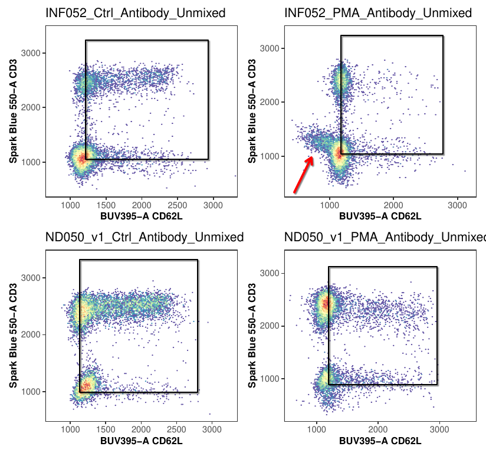

BUV395 serves as a good example about what to look for. When the unmixing is good, most of the cell populations will be symetrical around the x or y-axis (as shown by the straight line/rectangle), with any double-negative or double-positive population appearing in their respective corners depending on the underlying biology of their markers. When an unmixing issue occurs, this imaginary straight vertical/horizontal line through the middle of the single-positive populations will be shifted, as can be seen in BUV496

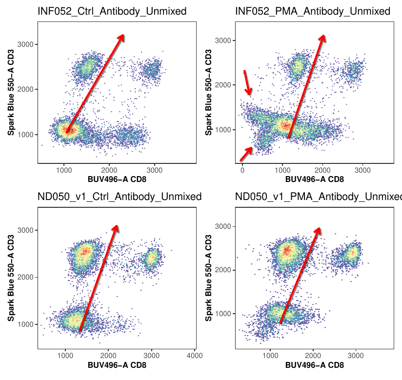

Likewise, INF052 PMA BUV395 and several of the BUV496 show "blebs", where a sub-population is not correctly unmixing, and is separating from the main population of cells. This can occur for various reasons as we will see later today, but the main ones in well-designed panels tend to be variation due to those cells autofluorescence; damage to tandems in a cell-subset specific manner, or co-expression patterns that result in fluorophores with high overlap being on the same cell. All three of these introduce uncertainty, which when OLS is run can result in blebs appearing in the unmixing. 

One thing to note, using `ggcyto` and our current transform settings, the axis are showing as "linear-like" values. For this panel, negative cells should be roughly centered around 1000, positive cells roughly around 3000 (with some variation for brighter fluorophores). Consequently, the 500 values seen for INF052 PMA would be the equivalent of seeing 10^-4 values on the Cytek Aurora's SpectroFlo software. 

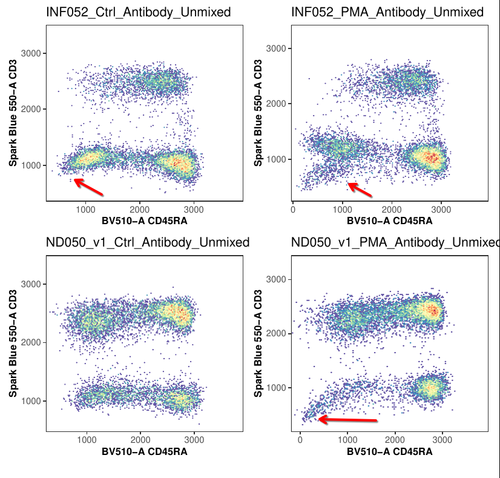

As we scroll through, we see occasional issues here and there, but so far, most tend to be concentrated in areas that overlap with the main autofluorescence for PBMCs (adjacent to UV7, V7 and B3 detectors). However, when looking at the Unity plots, we can also see differences that are related to the underlying biology or treatment. For example, our IFNg showing differences for the activation condition

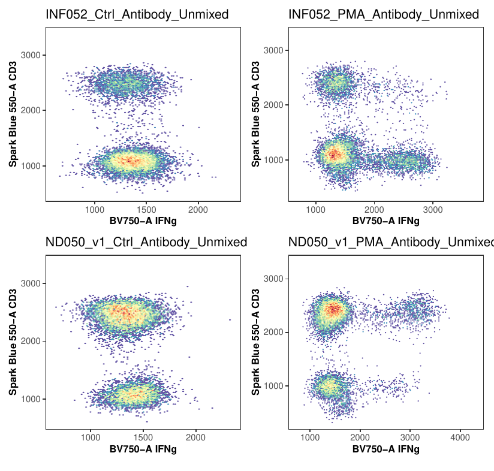

Or our CD27 showing differences between cord blood vs. adult peripheral blood

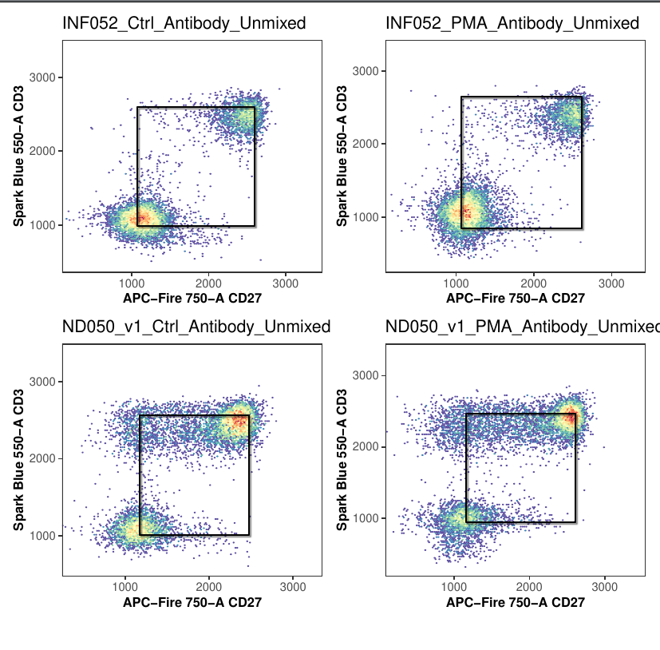

Unfortunately, once we hit the Red-laser fluorophores, we start encountering major unmixing issues. 

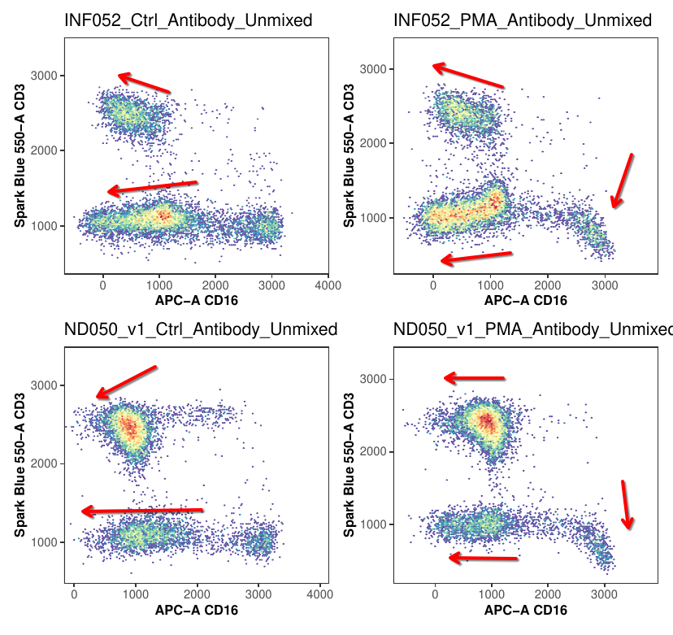

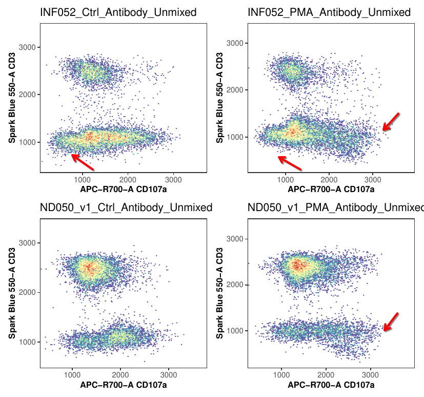

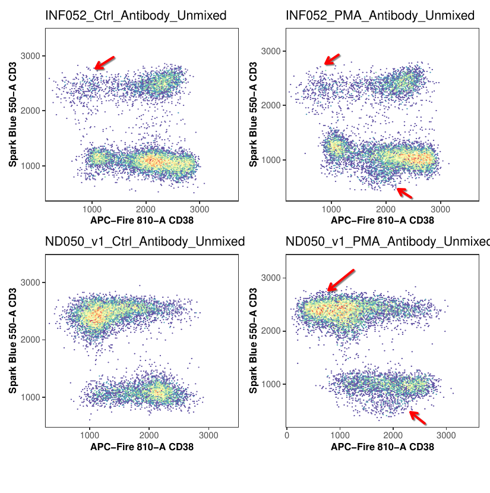

Given that we saw tandem degradation when screening with [Luciernaga](/course/SDY3080/LuciernagaIntegration.qmd), not shocking, but still terrifying. So ultimately, time to prioritize. The red-laser fluorophores are the worst in the unmixing, so addressing those takes priority. Once done, we can see about handling what can be broadly summarized as autofluorescent-similar problems, which could be to either the presence of an additional autofluorescence that was not accounted for in the matrix, or autofluorescent leftovers being present in too many signatures. We will tackle these in turn. 

### Signature Comparisons

Before diving too far, let's build off [Week 13](/course/13_SpectralSimilarities/index.qmd) and try to quickly visualize our signatures (originating from the cell unmixing controls) to reference signatures, to see if we can spot those that are substantially off for future investigation. First off, lets retrieve our fluorophore list (removing the unstained)

```{r}
ThePanel <- AssembledSignatures
ThePanel <- ThePanel[1:(nrow(ThePanel) -1),] # Remove AF
ThePanel <- ThePanel |> mutate(Source = "Original") |>
     relocate(Source, .after=Antigen)

TheseFluorophores <- ThePanel |> pull(Fluorophore)
```

Then similar to what we have done previously, lets retrieve the reference signatures for those fluorophores, before combining the dataframes. 

```{r}
Data <- Luciernaga:::InstrumentReferences(64) |>
     dplyr::filter(Fluorophore %in% TheseFluorophores) 

ReferenceData <- Data |> select(-Instrument) |>
      tidyr::pivot_wider(names_from="Detector",
      values_from="AdjustedY")

Numerics <- sapply(ReferenceData, is.numeric)
colnames(ReferenceData)[Numerics] <- paste0(colnames(ReferenceData)[Numerics], "-A")     
      
ReferenceData <- ReferenceData |> mutate(Source = "Reference") |>
      relocate(Source, .after=Fluorophore)

Comparisons <- bind_rows(ThePanel, ReferenceData) |> select(-Antigen)
```

We can then utilize `VisualizeSignatures()` to visualize both our signature and the reference in a single plot. 

```{r}
#| eval: FALSE

ComparisonPlots <- map(.x=TheseFluorophores, .f=VisualizeSignatures,
    characterColumns=c("Fluorophore", "Source"),
    data=Comparisons, columnname="Fluorophore")
```

Once all plots are returned, we can send them to a .pdf via `Utility_Patchwork()`

```{r}
#| eval: FALSE

Utility_Patchwork(x=ComparisonPlots, filename="SignatureComparisons",
 outfolder=StashHere, thecolumns=1, therows=3, NotListofList = FALSE,
 returntype="pdf")
```

While scrolling through SignatureComparisons.pdf, in addition to the expected discrepancy with APC-Fire 810, the main autofluorescence leftovers integrated into the signature appear to be occuring for both BV421 and PerCP-Cy5.5, so we can prioritize them for a second look. 

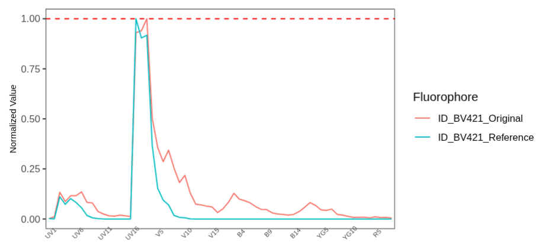

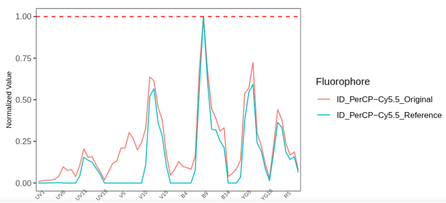

## Iterative Unmixing

When it comes to unmixing errors, tackle the worst ones first. In this case, lets go after APC-Fire 810, and use it to build out the infrastructure we will need to swap in the variant signatures for iterative unmixing. 

### APC-Fire 810

Lets begin by brining in the variant signatures that were retrieved using `LuciernagaIntegration()` during the [Luciernaga](/course/SDY3080/LuciernagaIntegration.qmd) walk-through.  

```{r}
TheCSV <- csv_files[stringr::str_detect(csv_files, "APCFire")]
TheSignatures <- read.csv(TheCSV, check.names=FALSE)

Plot <- VisualizeSignatures(data=TheSignatures, columnname="Cluster")
```

```{r}
plotly::ggplotly(Plot)
```

As we can see, we get back quite a few signatures, not all of them sufficiently distinct enough to merit investigation. For now, lets try to evalute for these representative signatures that span different heights for the R1 detector step-ladder that we see. 

```{r}
Representative <- TheSignatures |>
     dplyr::filter(Cluster %in% c(
        "R8_10-R1_10-YG5_04", "R8_10-R1_07-YG5_02", 
        "Average", "R8_10-R1_01-YG5_01")) |>
        rename(Fluorophore=Cluster)
```

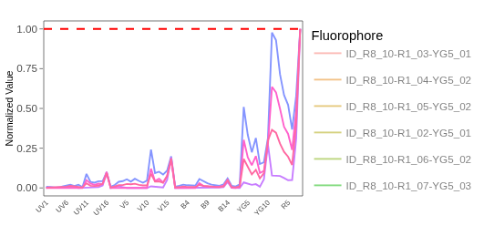

As we can see, the "Average" signature we retrieved still has substantial amounts of APC contribution present. Lets also check what their cosine similarity value is compared to each other. We could do this either with the code provided during [Week 13](/course/13_SpectralSimilarities/index.qmd#visualizing-cosine) or using `Lucieraga_Cosine()`. I generally set lower limit of the color gradient at 0.9, as it becomes really easy to spot signatures that are not anywhere close to identical to each other. 

```{r}
Luciernaga_Cosine(data=Representative, colorlow="lightblue", limitlow=0.9)
```

Enough variation across the board, this should prove interesting. Lets proceed to iteratively unmix! But first, lets create a subfolder. 

```{r}
StashHere <- file.path(OutputLocation, "IteratedAPCFire810")

if (!dir.exists(StashHere)){dir.create(StashHere)}
```

#### IteratedUnmix

Alright, so how do we set up for iterative unmixing? If you guessed we make a new [function](/course/09_Functions/index.qmd), then you have been paying attention. We already have our main signature matrix, but we also have a data.frame that contains the variant signatures as well. So we will need to provide that, but then have a way to filter down just for the row that we want to swap in, at which point the modified signature matrix can be used to unmix the .fcs files. 

We will try something different today, and use `dplyr`'s `rows_update()` function. Tracking the function arguments (located inside the ()), see if you can decipher how it works

```{r}
# x <- "R8_10-R1_10-YG5_04"
# AlternateMatrix <- Representative
# SignatureMatrix <- AssembledSignatures
# outpath <- StashHere
# ThisFluorophore <- "APC-Fire 810"

IteratedUnmix <- function(x, AlternateMatrix, ThisFluorophore, 
  SignatureMatrix, fcs_files,  outpath){

    SignatureMatrix <- SignatureMatrix |>
    dplyr::rows_update(
        AlternateMatrix |>
        dplyr::filter(Fluorophore %in% x) |>
        dplyr::mutate(Fluorophore = ThisFluorophore),
        by = "Fluorophore"
    )

    theAddOn <- paste0(x, "_Unmixed")

    walk(.x=fcs_files, .f=OldFashionedUnmix, 
        SignatureData=SignatureMatrix, returnType="fcs",
        outpath=outpath, addon=theAddOn)
}
```

Once the function is written, don't forget to run the code chunk, which results in it becoming active in your session. At this point, we can retrieve the names of the signature variants for use as a vector, and go ahead and iterate out the variant .fcs files 

```{r}
#| eval: FALSE

SignatureVariants <- Representative |> pull(Fluorophore)

walk(.x=SignatureVariants, .f=IteratedUnmix, fcs_files=fcs_files,
 AlternateMatrix = Representative,SignatureMatrix = AssembledSignatures,
 outpath = StashHere,ThisFluorophore = "APC-Fire 810")
```

At which point, we just need to load these variant .fcs files into a GatingSet, transform and from there visualize to see what outcome the different APC-Fire 810 signatures had on our unmixing. 

```{r}
TheseFCSFiles <- list.files(StashHere,
 pattern=".fcs", full.names=TRUE)
TheCytoset <- load_cytoset_from_fcs(TheseFCSFiles,
 truncate_max_range=FALSE, transformation=FALSE)
TheGatingSet <- GatingSet(TheCytoset)

SFC_Parameters <- colnames(TheGatingSet)
FluorophoresOnly <- SFC_Parameters[!stringr::str_detect(SFC_Parameters, "FSC|SSC|Time")]
Biexponential <-  flowjo_biexp_trans(channelRange=4096,
 maxValue=4194304, pos=5.62, neg=0, widthBasis=-1000)
MyBiexTransform <- transformerList(FluorophoresOnly, Biexponential)
transform(TheGatingSet, MyBiexTransform)
```

```{r}
#| eval: FALSE

IterateThroughTheseColumns <- FluorophoresOnly [!stringr::str_detect(FluorophoresOnly, "APC-A")]

AssembledPlots <- map(.x= IterateThroughTheseColumns[23:28],
 .f=Utility_UnityPlot, y="APC-A",
 GatingSet=TheGatingSet, sample.name="GUID", bins=120,
 removestrings="_Unmixed.fcs", marginsubset="root",
 gatesubset="root", returntype="patchwork", reference=NULL,
 clearance=0.2, gatelines=FALSE, therows=2, thecolumns=2)
```

```{r}
#| eval: FALSE

Utility_Patchwork(x=AssembledPlots, filename="IteratedAPCFire810_APCImpact",
 outfolder=StashHere, thecolumns=1, therows=1, NotListofList = FALSE,
 patches=TRUE)
```

#### Evaluating


As we look through the .pdf, it is really hard to determine which is the better signature variant .... just kidding, its quite obvious

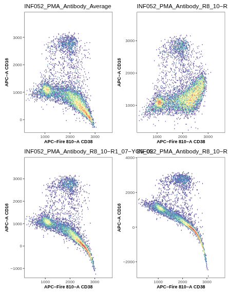

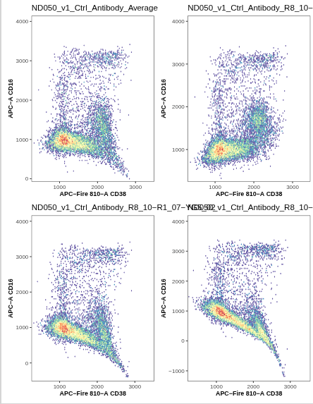

The one-caveat of using the APC-Fire 810 signature that is in good non-degraded shape is that it does result in the appearance of a low APC positive population. In the context of this panel, this is from CD38 APC-Fire 810 that got degraded down to a CD38 APC, which is now also running around in the .fcs file in addition to the CD16 APC of the original panel.

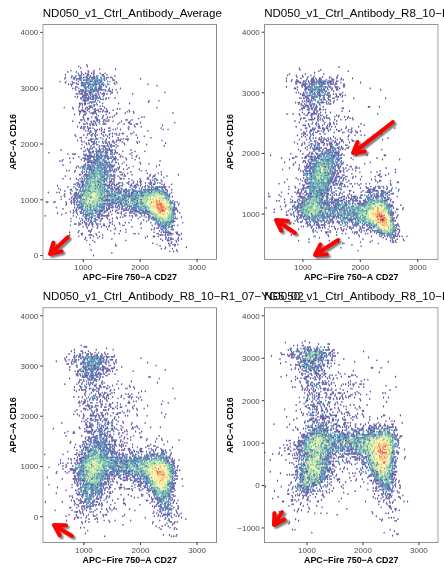

However, if you note the negative values, you can see that even though there isn't this additional separate population for the variant signatures where APC-Fire 810 has the contaminating APC signature, there is substantial spreading into the negative that is occuring due to the increased [collinearity](/course/13_SpectralSimilarities/index.qmd#collinearity) that has a more severe impact on the overall unmixing of the .fcs file as a whole. 

Consequently, its probably safest to use the non-degraded signature variant of APC-Fire 810 going forward, and make a note to adjust the gate accordingly for low positive APC so we don't misatribute signal originating from the CD38 antibody to CD16. To swap in the desired signature, we can extract the tidying code from `IteratedUnmix()` and modify our original signature matrix, saving under a new object/variable name. 

```{r}
AlternateMatrix <- Representative
SignatureMatrix <- AssembledSignatures
ThisFluorophore <- "APC-Fire 810"
ThisVariant <- "R8_10-R1_01-YG5_01"

UpdatedSignatureMatrix <- SignatureMatrix |>
    dplyr::rows_update(
        AlternateMatrix |>
        dplyr::filter(Fluorophore %in% ThisVariant) |>
        dplyr::mutate(Fluorophore = ThisFluorophore),
        by = "Fluorophore"
    )

# UpdatedSignatureMatrix |> View()
```

#### Hotspots

Seeing as we can see issues for some of the variants due to increased collinearity, lets go ahead and generate unmixing-dependent hotspot matrices from [Week 13](/course/13_SpectralSimilarities/index.qmd#collinearity) to get a better idea of the fluorophore neighborhoods that might be affected. At the same time, by contrasting the original matrix to the one where we swap in the signature we want to keep, we can see if the difference is predictive of where we saw improved unmixing in the .pdf. 

Lets start by generating the plots, and saving them out since their dimensions don't play well directly outputting in Positron. 

```{r}
#| eval: FALSE
OldHotspot <- Hotspots(data=SignatureMatrix,
 fileName="OriginalAPCFire810",
 outpath = StashHere,
 returnType="plot")
```

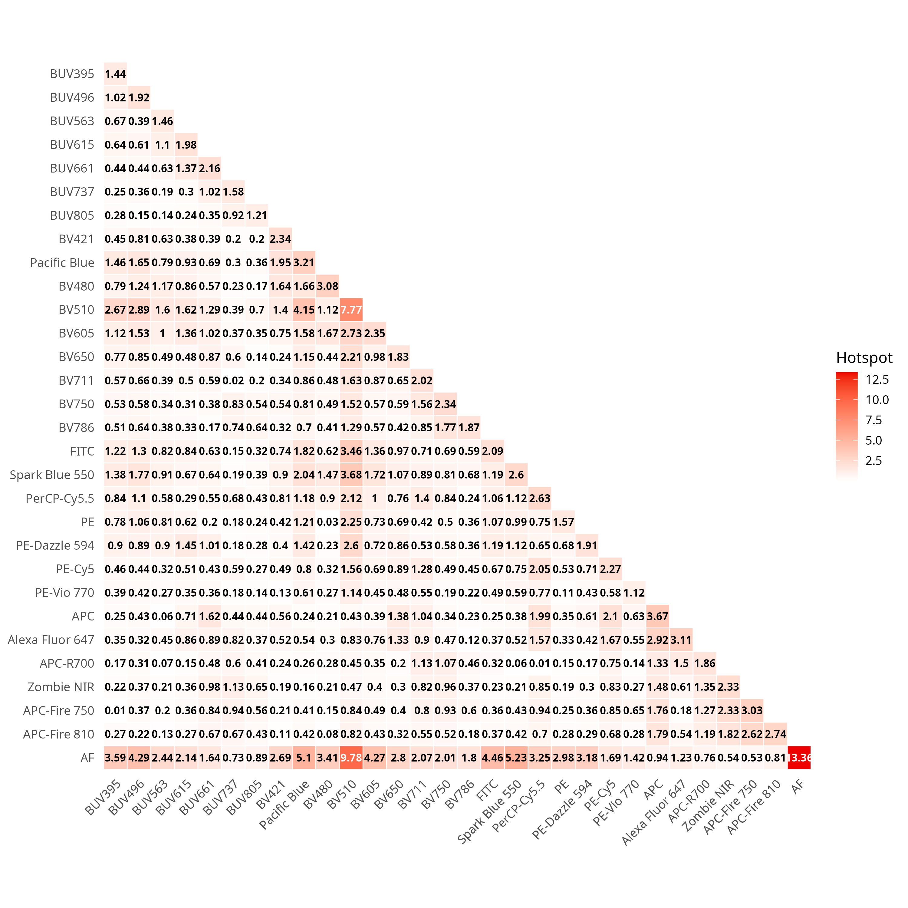

```{r}
#| eval: FALSE
UpdatedHotspot <- Hotspots(data=UpdatedSignatureMatrix,
 fileName="UpdatedAPCFire810",
 outpath = StashHere,
 returnType="plot")
```


While both can be zoomed in on and investigated independently, seeing as they are both the same dimensions, we have the ability to subtract the values from each other, and then visualize the difference in the same view. To do this, lets set returnType for each as "data"

```{r}
OldHotspot <- Hotspots(data=SignatureMatrix,
 fileName="OriginalAPCFire810",
 outpath = StashHere,
 returnType="data")

UpdatedHotspot <- Hotspots(data=UpdatedSignatureMatrix,
 fileName="UpdatedAPCFire810",
 outpath = StashHere,
 returnType="data")
```

At this point, we can pass to `HotspotDifference()` (which is saved in this weeks "R" folder) which mediates the subtraction and plot generation. 
```{r}
#| eval: FALSE

HotspotDifference(HotspotBrighter=OldHotspot,
 HotspotDimmer=UpdatedHotspot, outpath=StashHere,
 fileName = "Difference_APCFire810")
```

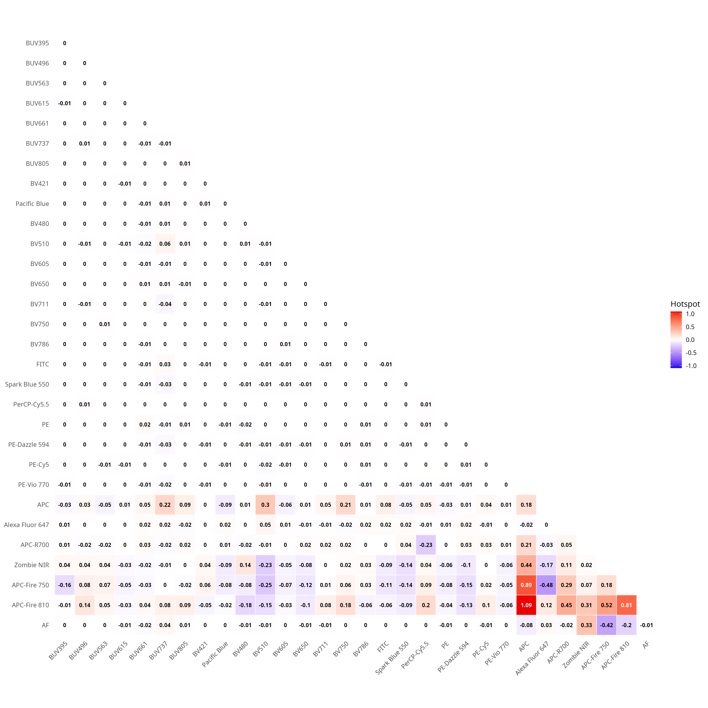

And sure enough, the larger positive difference values (in red) track the marker combinations for which we saw major improvement going from the "degraded APC-Fire 810" signature to the "intact APC-Fire 810" signature. 

But what about the negative "blue" values? Alexa Fluor 647 vs APC-Fire 750 is at -0.48. Well, let's generate the plot and check. 

```{r}
plot <- map(.x= "APC-Fire 750-A", .f=Utility_UnityPlot,
 y="Alexa Fluor 647-A", GatingSet=TheGatingSet, sample.name="GUID",
 bins=120, removestrings="_Unmixed.fcs", marginsubset="root",
 gatesubset="root", returntype="patchwork", reference=NULL,
 clearance=0.2, gatelines=FALSE, therows=2, thecolumns=2)
```

```{r}
plot
```

Glancing at the x-axis for APC-Fire 750, the negative population does appear to spread out a a bit on the non-degraded signature vs the others. So some of the originally misdirected signal was actually helping this unmixing at the margins. But overall, minor compared to what we witnessed in improvements across the other markers. Lets call it good for now and move on to swapping in some other markers. 

### PerCP-Cy5.5

Having swapped out the degraded tandem degradation signature, lets tackle a couple fluorophores that both the signature comparisons and [Luciernaga](/course/SDY3080/LuciernagaIntegration.qmd) walkthrough had flagged as having incorporated autofluorescence in their overall signature. In interest of time, we will focus on just a couple of these for now, starting with PerCP-Cy5.5. 

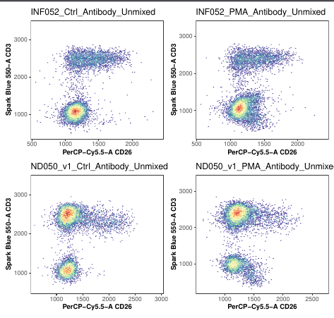

Compared to to the reference, our cell signature has slight variation to peaks, and a bit of autofluorescence leftover peaks around V7, UV7 and B3. 


Which we can also see when we contrast against the bead-derived signature that we generated

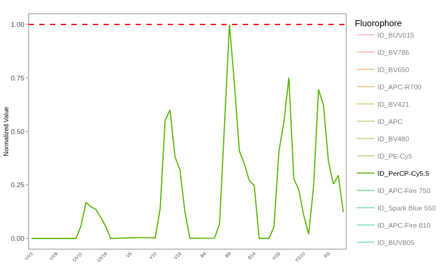

Lets repeat the code chunks from above (still visible by clicking on the fold-dropdown) and retrieve the corresponding .csv of variant signatures, and visualize them. 

```{r}
#| code-fold: TRUE
TheCSV <- csv_files[stringr::str_detect(csv_files, "PerCP")]
TheSignatures <- read.csv(TheCSV, check.names=FALSE)

Plot <- VisualizeSignatures(data=TheSignatures, columnname="Cluster")
```

```{r}
#| code-fold: TRUE
plotly::ggplotly(Plot)
```

As you can tell, a lot of overlaps. Lets pick a few signatures of interest from across this gradient. 

```{r}
#| code-fold: TRUE
Representative <- TheSignatures |> dplyr::filter(
    Cluster %in% c("B9_10-YG6_07-V13_07", "B9_10-YG6_07-V13_06",
     "Average", "B9_10-YG6_05-V13_05")) |> rename(Fluorophore=Cluster)
```

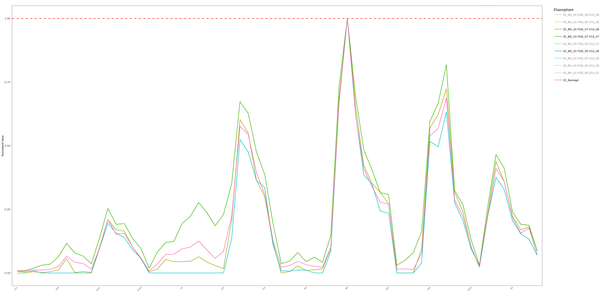

And checking quickly the cosine similarity, we find that despite visual difference, they all still are relatively close to each other compared to the APC-Fire 810 signatures. This is partly due to the extra autofluorescent peaks only making up a minor contribution to the overall area under the signature curve for the overall fluorophore peaks. 

```{r}
#| code-fold: TRUE
Luciernaga_Cosine(data=Representative, colorlow="lightblue",
 limitlow=0.9)
```

To keep things organized, lets place everything into its own subfolder. 

```{r}
#| code-fold: TRUE
StashHere <- file.path(OutputLocation, "IteratedPerCP-Cy55")

if (!dir.exists(StashHere)){dir.create(StashHere)}

SignatureVariants <- Representative |> pull(Fluorophore)
```

Then carry out iterative unmixing for the respective signature variants. 

```{r}
#| code-fold: TRUE
#| eval: FALSE

walk(.x=SignatureVariants, .f=IteratedUnmix, fcs_files=fcs_files,
 AlternateMatrix = Representative, SignatureMatrix = UpdatedSignatureMatrix,
 outpath = StashHere,ThisFluorophore = "PerCP-Cy5.5")
```

Read these .fcs files back in, and generate the corresponding visuals

```{r}
#| code-fold: TRUE
TheseFCSFiles <- list.files(StashHere, pattern=".fcs", full.names=TRUE)
TheCytoset <- load_cytoset_from_fcs(TheseFCSFiles,
 truncate_max_range=FALSE, transformation=FALSE)
TheGatingSet <- GatingSet(TheCytoset)

SFC_Parameters <- colnames(TheGatingSet)
FluorophoresOnly <- SFC_Parameters[!stringr::str_detect(SFC_Parameters, "FSC|SSC|Time")]
Biexponential <-  flowjo_biexp_trans(channelRange=4096,
 maxValue=4194304, pos=5.62, neg=0, widthBasis=-1000)
MyBiexTransform <- transformerList(FluorophoresOnly, Biexponential)
transform(TheGatingSet, MyBiexTransform)
```

```{r}
#| code-fold: TRUE
#| eval: FALSE

IterateThroughTheseColumns <- FluorophoresOnly [!stringr::str_detect(FluorophoresOnly, "PerCP")]

AssembledPlots <- map(.x= IterateThroughTheseColumns,
 .f=Utility_UnityPlot, y="PerCP-Cy5.5-A", GatingSet=TheGatingSet,
 sample.name="GUID", bins=120, removestrings="_Unmixed.fcs",
 marginsubset="root", gatesubset="root", returntype="patchwork",
 reference=NULL, clearance=0.2, gatelines=FALSE, therows=2, thecolumns=2)
```

Before saving to a .pdf

```{r}
#| code-fold: TRUE
#| eval: FALSE

Utility_Patchwork(x=AssembledPlots, filename="IteratedPerCPCy5.5",
 outfolder=StashHere, thecolumns=1, therows=1, NotListofList = FALSE,
 patches=TRUE)
```

Lets save the cell-derrived signature with the less autofluorescence contributions, and update the signature matrix. 

```{r}
#| code-fold: TRUE

AlternateMatrix <- Representative
SignatureMatrix <- AssembledSignatures
ThisFluorophore <- "PerCP-Cy5.5"
ThisVariant <- "B9_10-YG6_05-V13_05"

UpdatedSignatureMatrix2 <- UpdatedSignatureMatrix |>
    dplyr::rows_update(
        AlternateMatrix |>
        dplyr::filter(Fluorophore %in% ThisVariant) |>
        dplyr::mutate(Fluorophore = ThisFluorophore),
        by = "Fluorophore"
    )

# UpdatedSignatureMatrix2 |> View()
```

At which point, we can repeat the generation of the hotspot matrices, and the change between them matrix plot


```{r}
#| code-fold: TRUE
#| eval: FALSE

OldHotspot <- Hotspots(data=UpdatedSignatureMatrix,
 fileName="OriginalPerCPCy55",
 outpath = StashHere,
 returnType="plot")
```


```{r}
#| code-fold: TRUE
#| eval: FALSE
UpdatedHotspot <- Hotspots(data=UpdatedSignatureMatrix2,
 fileName="UpdatedPerCPCy55",
 outpath = StashHere,
 returnType="plot")
```

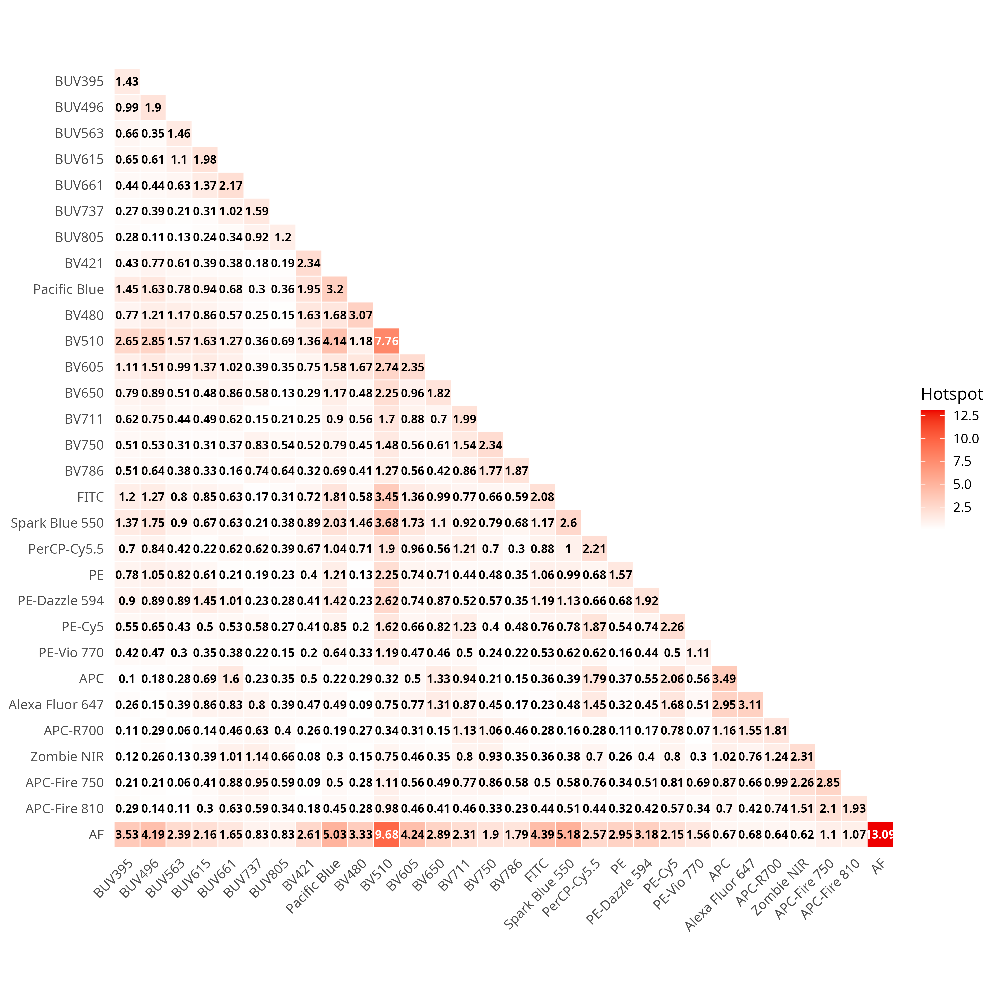

```{r}
#| code-fold: TRUE
OldHotspot <- Hotspots(data=UpdatedSignatureMatrix,
 fileName="OriginalPerCPCy55",
 outpath = StashHere,
 returnType="data")

UpdatedHotspot <- Hotspots(data=UpdatedSignatureMatrix2,
 fileName="UpdatedPerCPCy55",
 outpath = StashHere,
 returnType="data")

HotspotDifference(HotspotBrighter=OldHotspot,
 HotspotDimmer=UpdatedHotspot, outpath=StashHere,
 fileName = "Difference_PerCPCy55")
```

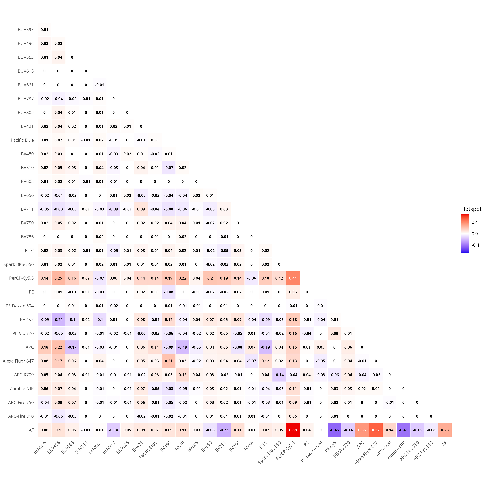

Overall, looking at the difference plot, switching out this signature variant does not appear to have made any substantial differences across most fluorophores, with most of the difference values being less than 0.3. When we open IteratedPerCPCy5.5 on these values, the changes also appear to be relatively minor, as can be seen in the following example:

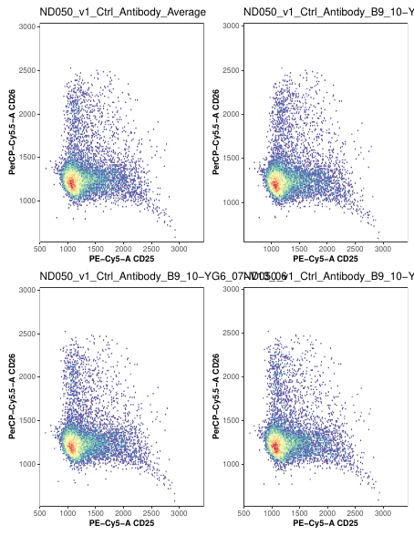

So in this case, while switching the signature didn't hurt, it certainly didn't appear to help all that much, at least for the moment. 

### BV421

Moving on from the limited changes from switching out PerCP-Cy5.5, lets check on BV421. 

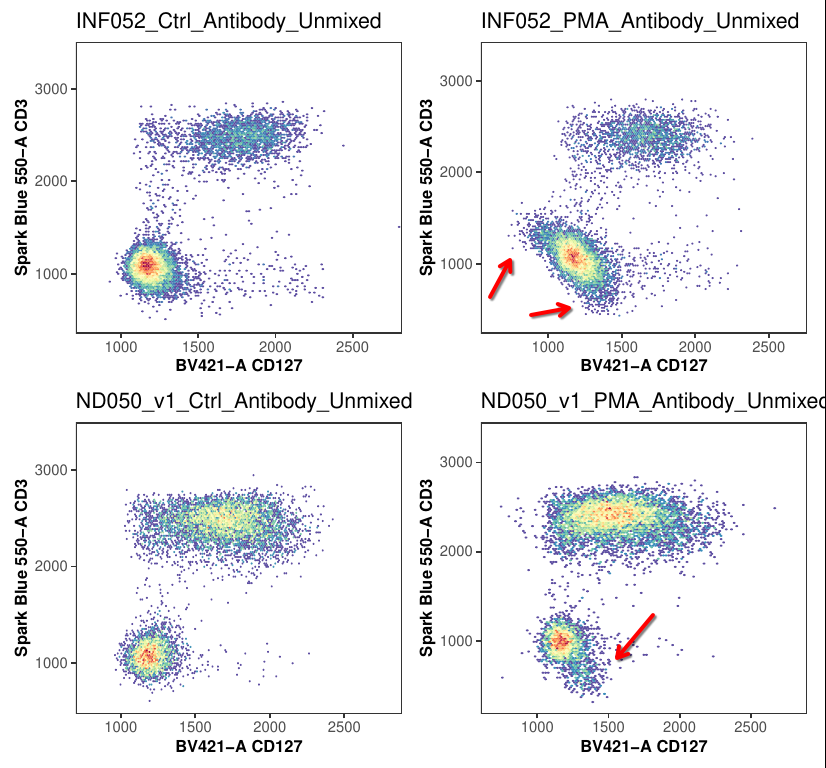


From the [Luciernaga](/course/SDY3080/LuciernagaIntegration.qmd) run, all signature variants came back across the board as having the V3-A as their peak detector. This is a little odd, given that the main reference signature is supposed to be V1-A based on the reference. 


Whether this small difference is due to the instrument, or changes in the vial due to something the manufacturer did, is a different investigation. For now, since its consistent across the board, lets see what we can do to provide a representative signature that has less autofluorescence residuals present. 

As was the case for the above, load in the signature variants

```{r}
#| code-fold: TRUE
TheCSV <- csv_files[stringr::str_detect(csv_files, "BV421")]
TheSignatures <- read.csv(TheCSV, check.names=FALSE)

Plot <- VisualizeSignatures(data=TheSignatures, columnname="Cluster")
```

```{r}
#| code-fold: TRUE
plotly::ggplotly(Plot)
```

Lets select a few along the gradient of the autofluorescence shoulder, and compare how they look.  

```{r}
#| code-fold: TRUE
Representative <- TheSignatures |>
     dplyr::filter(Cluster %in% c(
        "V3_10-V2_10-V7_08", "V3_10-V2_10-UV8_03", "Average",
         "V3_10-V2_10-UV6_01")) |> 
    rename(Fluorophore=Cluster)
```

```{r}
#| code-fold: TRUE
Luciernaga_Cosine(data=Representative, colorlow="lightblue",
 limitlow=0.9)
```

Bit more variation than what we experienced with the PerCP-Cy5.5, so hopefully enough to make an impact on unmixing. Lets generate a subfolder and proceed with the iterative unmixing through these signature variants. 

```{r}
#| code-fold: TRUE
StashHere <- file.path(OutputLocation, "IteratedBV421")

if (!dir.exists(StashHere)){dir.create(StashHere)}

SignatureVariants <- Representative |> pull(Fluorophore)
```

```{r}
#| code-fold: TRUE
#| eval: FALSE
walk(.x=SignatureVariants, .f=IteratedUnmix,
 fcs_files=fcs_files, AlternateMatrix = Representative,
 SignatureMatrix = UpdatedSignatureMatrix2,
 outpath = StashHere,ThisFluorophore = "BV421")
```

And then read back in the .fcs files, visualize them, and send them back to a .pdf for easier comparison. 

```{r}
#| code-fold: TRUE
TheseFCSFiles <- list.files(StashHere,
 pattern=".fcs", full.names=TRUE)
TheCytoset <- load_cytoset_from_fcs(TheseFCSFiles,
 truncate_max_range=FALSE, transformation=FALSE)
TheGatingSet <- GatingSet(TheCytoset)

SFC_Parameters <- colnames(TheGatingSet)
FluorophoresOnly <- SFC_Parameters[!stringr::str_detect(SFC_Parameters, "FSC|SSC|Time")]
Biexponential <-  flowjo_biexp_trans(channelRange=4096,
 maxValue=4194304, pos=5.62, neg=0, widthBasis=-1000)
MyBiexTransform <- transformerList(FluorophoresOnly, Biexponential)
transform(TheGatingSet, MyBiexTransform)
```

```{r}
#| code-fold: TRUE
#| eval: FALSE

IterateThroughTheseColumns <- FluorophoresOnly[!stringr::str_detect(FluorophoresOnly, "BV421-A")]

AssembledPlots <- map(.x= IterateThroughTheseColumns,
 .f=Utility_UnityPlot, y="BV421-A",
 GatingSet=TheGatingSet, sample.name="GUID", bins=120,
 removestrings="_Unmixed.fcs", marginsubset="root",
 gatesubset="root", returntype="patchwork", reference=NULL,
 clearance=0.2, gatelines=FALSE, therows=2, thecolumns=2)
```

```{r}
#| code-fold: TRUE
#| eval: FALSE

Utility_Patchwork(x=AssembledPlots, filename="IteratedBV421",
 outfolder=StashHere, thecolumns=1, therows=1, NotListofList = FALSE,
 patches=TRUE)
```

As we look through the unmixing result, we start noticing a few changes. Lets keep the autofluorescence minimal and proceed to generate the hotspot differential plots. 

```{r}
#| code-fold: TRUE
AlternateMatrix <- Representative
SignatureMatrix <- AssembledSignatures
ThisFluorophore <- "BV421"
ThisVariant <- "V3_10-V2_10-UV6_01"

UpdatedSignatureMatrix3 <- UpdatedSignatureMatrix2 |>
    dplyr::rows_update(
        AlternateMatrix |>
        dplyr::filter(Fluorophore %in% ThisVariant) |>
        dplyr::mutate(Fluorophore = ThisFluorophore),
        by = "Fluorophore"
    )

# UpdatedSignatureMatrix2 |> View()
```


```{r}
#| code-fold: TRUE
#| eval: FALSE

OldHotspot <- Hotspots(data=UpdatedSignatureMatrix2,
 fileName="OriginalBV421",
 outpath = StashHere,
 returnType="plot")
```


```{r}
#| code-fold: TRUE
#| eval: FALSE
UpdatedHotspot <- Hotspots(data=UpdatedSignatureMatrix3,
 fileName="UpdatedBV421",
 outpath = StashHere,
 returnType="plot")
```

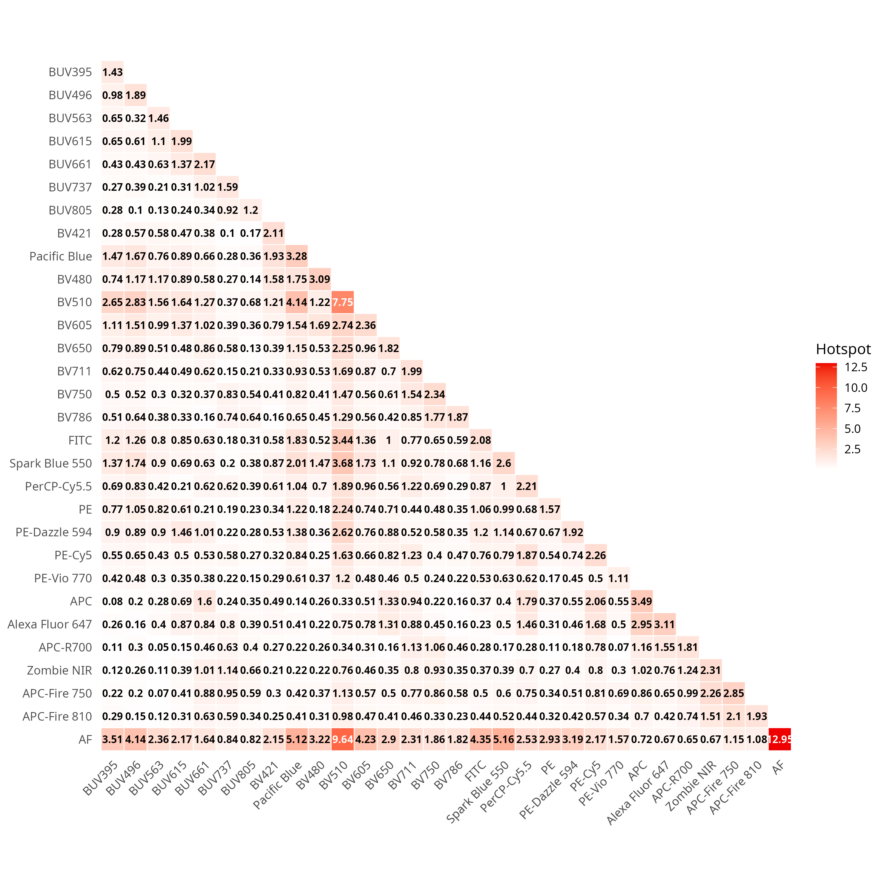

```{r}
#| code-fold: TRUE
OldHotspot <- Hotspots(data=UpdatedSignatureMatrix2,
 fileName="OriginalBV421",
 outpath = StashHere,
 returnType="data")

UpdatedHotspot <- Hotspots(data=UpdatedSignatureMatrix3,
 fileName="UpdatedBV421",
 outpath = StashHere,
 returnType="data")

HotspotDifference(HotspotBrighter=OldHotspot,
 HotspotDimmer=UpdatedHotspot, outpath=StashHere,
 fileName = "Difference_BV421")
```

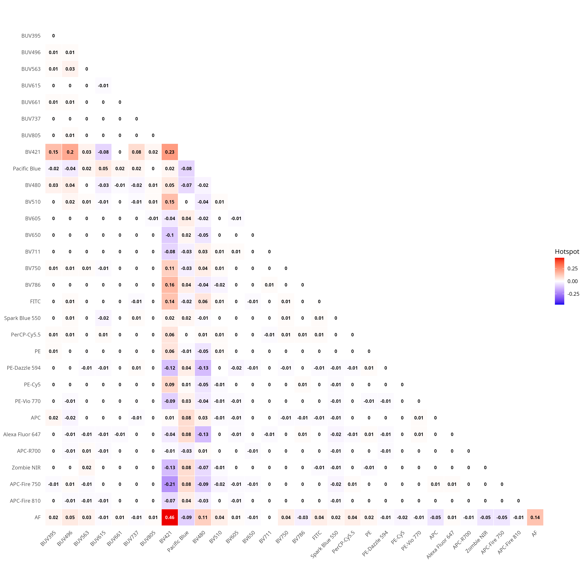

However, once again, while the difference would suggest small improvements for BUV496, and slightly worse for APC-Fire 750... actual visualization shows a different story:

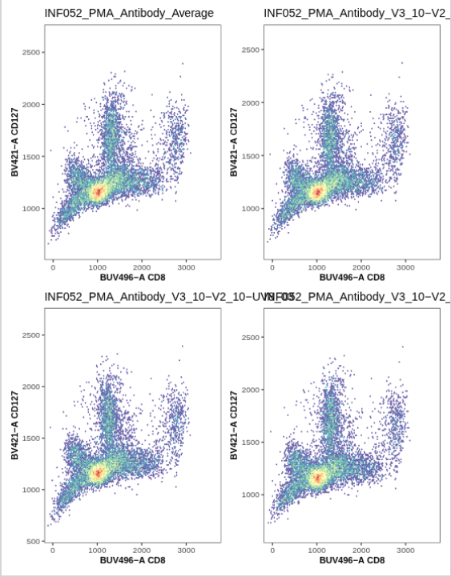

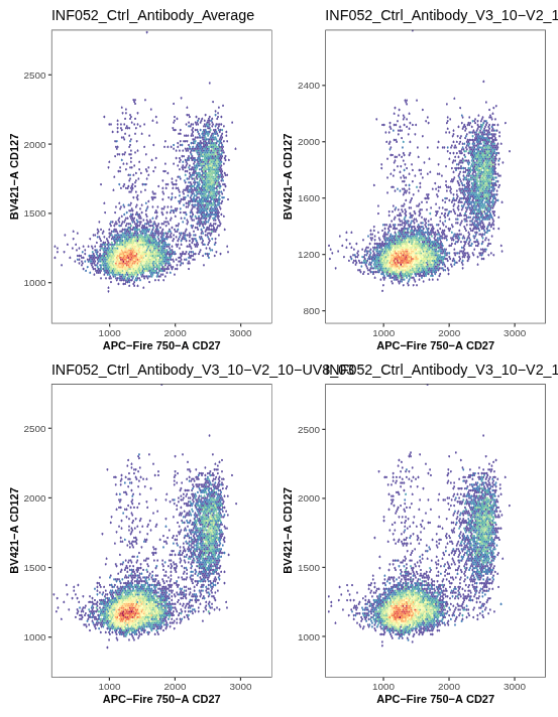

So far, this metric has only really proved useful in context of APC-Fire 810, so it looks like we are figuring out in real time that the lower bound of differences that actually impact this particular panel are somewere above 0.4

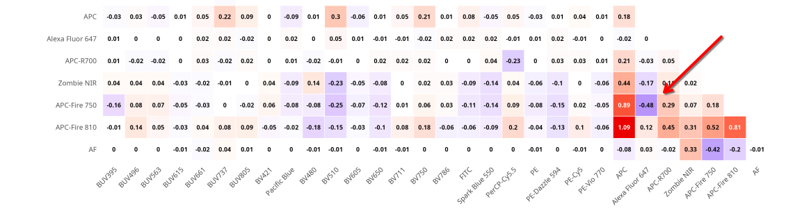

When screening through the .pdfs for the last two fluorophores, the main unmixing issues continue to be for fluorophores that are autofluorescence-similar. These are typically those markers that are first affected when an additional autofluorescence is present, so lets go ahead and see what impact this would have on our panel. 

## Autofluorescence

As we have worked our way through evaluating the .pdf outputs, we have consistently noticed a couple things in terms of where we are seeing the remaining unmixing errors. One, for autofluorescent similar fluorophores (like BUV496, BV510, Spark Blue 550), we see blebs on the negative populations

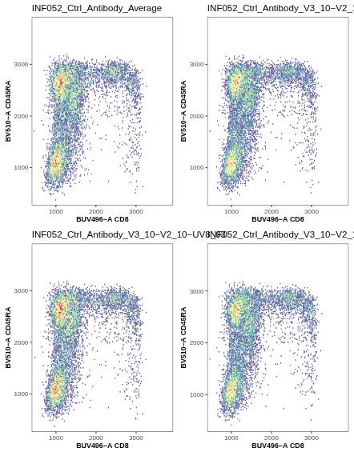

But these are particularly worse for the PMA-ionomycin stimulated condition

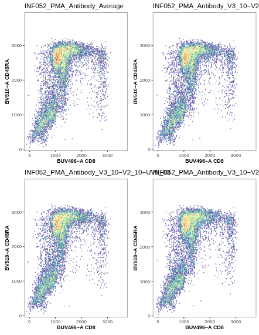

However, the extent is donor specific, as the adult PBMC donor for control seems to be behaving normally

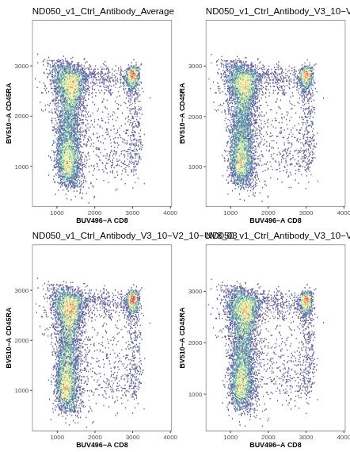

With only minor whispy-ness visible for it's PMA-ionomycin activated condition

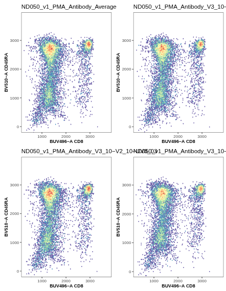

It is likely that part of what we are encountering is that for the cells that are unmixing incorrectly, their cellular autofluorescence is sufficiently different enough from that of the other cells to merit a separate autofluorescence signature. While still partly resembling the main autofluorescence, the variation results in uncertainty, and in making the math fit, least squares ends up taking signal away from the autofluorescent fluorophores to make the math work, resulting in these super-negative populations. 

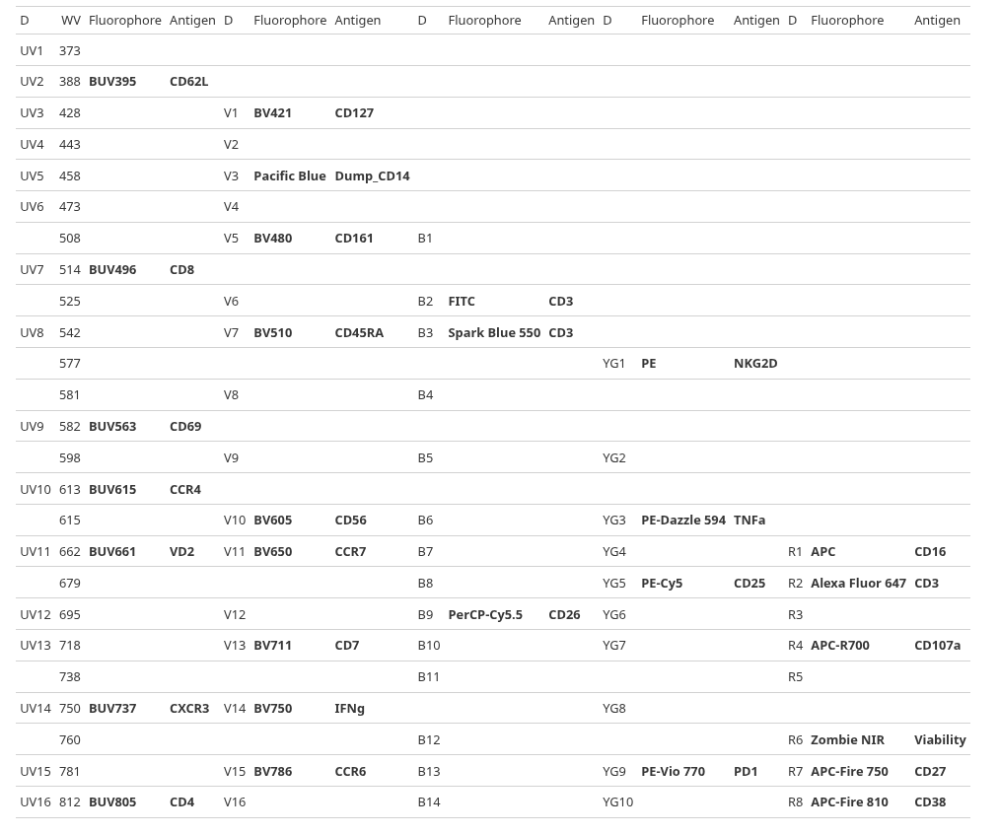

To troubleshoot this, we will need to first retrieve the autofluorescent signatures that we isolated during the [Luciernaga](/course/SDY3080/LuciernagaIntegration.qmd) walk-through for each of the donors activation conditions, and see if we can figure out the signature variants that are substantially different from the main. We can then target these for inclusion as a second autofluorescent signature in the unmixing matrix. 

We can start by reading in the variant signatures for ND006 Ctrl and PMA-ionomycin activated conditions

```{r}
TheCSV <- csv_files[stringr::str_detect(csv_files, "ND006Ctrl")]
TheSignatures <- read.csv(TheCSV, check.names=FALSE)

TheCSV <- csv_files[stringr::str_detect(csv_files, "ND006PMA")]
TheSignatures2 <- read.csv(TheCSV, check.names=FALSE)
TheSignatures2 <- TheSignatures2 |> filter(!Cluster %in% "Average")
TheSignatures <- bind_rows(TheSignatures, TheSignatures2)

TheSignatures <- TheSignatures |> group_by(Cluster) |> slice(1) |> ungroup()

Plot <- VisualizeSignatures(data=TheSignatures, columnname="Cluster")
```

```{r}
plotly::ggplotly(Plot)
```

As we can see, based on the signature variant names, there are some signatures being retrieved that instead of having a main "V7" peak, instead have a "UV7" as the main peak, with smaller contribution arising from "UV7". Lets go ahead and add in the cord blood control unstained, and see if it also follows this pattern, or not. 

```{r}
TheCSV <- csv_files[stringr::str_detect(csv_files, "ND006Ctrl")]
TheSignatures <- read.csv(TheCSV, check.names=FALSE)

TheCSV <- csv_files[stringr::str_detect(csv_files, "ND006PMA")]
TheSignatures2 <- read.csv(TheCSV, check.names=FALSE)
TheSignatures2 <- TheSignatures2 |> filter(!Cluster %in% "Average")

TheCSV <- csv_files[stringr::str_detect(csv_files, "INF052Ctrl")]
TheSignatures3 <- read.csv(TheCSV, check.names=FALSE)
TheSignatures3 <- TheSignatures3 |> filter(!Cluster %in% "Average")

TheSignatures <- bind_rows(TheSignatures, TheSignatures2, TheSignatures3)

TheSignatures <- TheSignatures |> group_by(Cluster) |> slice(1) |> ungroup()

Plot <- VisualizeSignatures(data=TheSignatures, columnname="Cluster")
```

```{r}
plotly::ggplotly(Plot)
```

As we can see, cord blood while sharing the main V7 peak is shifted towards having B3 for its secondary peak, instead of the "UV7" secondary peak that is found in the autofluorescence for the adult PBMCs. So potentially, we might have yet another third autofluorescence variant that we would need to deal with. Lets first focus on just adding an additional second autofluorescence. Lets balence this initial run for now by providing two variants with substantial UV7, the current "Average" representing the "V7" primary, and one of cord blood signatures with the higher "B3" peaks.

```{r}
Representative <- TheSignatures |> dplyr::filter(
    Cluster %in% c("UV7_10-UV8_07-V7_06", "UV7_10-UV8_09-V7_08",
     "V7_10-B3_03-UV8_03", "V7_10-B3_09-UV8_03")) |> rename(Fluorophore=Cluster)
```

```{r}
Luciernaga_Cosine(data=Representative, colorlow="lightblue",
 limitlow=0.9)
```

### Second AF

Glancing, we can see that the UV7's are similar to each other, so likely only going to need one. But there remains substantial differences between main V7 and the B3 variants, which might also merit its addition. Lets go ahead and set up for iterative unmixing. First, lets create a subfolder. 

```{r}
StashHere <- file.path(OutputLocation, "IteratedAF")

if (!dir.exists(StashHere)){dir.create(StashHere)}

SignatureVariants <- Representative |> pull(Fluorophore)
```

We can then do some data tidying, to create a new a row for the second autofluorescence (which we will use to swap the variant signatures into)

```{r}
AdditionalAF <- UpdatedSignatureMatrix3 |> filter(Fluorophore %in% "AF") |> 
    mutate(Fluorophore ="AF2") |> mutate(Antigen ="Unstained2")

ComparisonMatrix <- bind_rows(UpdatedSignatureMatrix3, AdditionalAF)

# ComparisonMatrix |> View()
```

At which point, we can go ahead and run `IteratedUnmix`, before reading the .fcs files back in, visualizing them and sending to a pdf

```{r}
#| eval: FALSE
walk(.x=SignatureVariants, .f=IteratedUnmix, fcs_files=fcs_files,
 AlternateMatrix = Representative,SignatureMatrix = ComparisonMatrix,
 outpath = StashHere,ThisFluorophore = "AF2")
```

```{r}
TheseFCSFiles <- list.files(StashHere, pattern=".fcs", full.names=TRUE)
TheCytoset <- load_cytoset_from_fcs(TheseFCSFiles,
 truncate_max_range=FALSE, transformation=FALSE)
TheGatingSet <- GatingSet(TheCytoset)

SFC_Parameters <- colnames(TheGatingSet)
FluorophoresOnly <- SFC_Parameters[!stringr::str_detect(SFC_Parameters, "FSC|SSC|Time")]
Biexponential <-  flowjo_biexp_trans(channelRange=4096,
 maxValue=4194304, pos=5.62, neg=0, widthBasis=-1000)
MyBiexTransform <- transformerList(FluorophoresOnly, Biexponential)
transform(TheGatingSet, MyBiexTransform)
```

```{r}
#| eval: FALSE

IterateThroughTheseColumns <- FluorophoresOnly [!stringr::str_detect(FluorophoresOnly, "BV510-A")]

AssembledPlots <- map(.x= IterateThroughTheseColumns, .f=Utility_UnityPlot,
 y="BV510-A", GatingSet=TheGatingSet, sample.name="GUID", bins=120,
 removestrings="_Unmixed.fcs", marginsubset="root", gatesubset="root",
 returntype="patchwork", reference=NULL, clearance=0.2, gatelines=FALSE,
 therows=2, thecolumns=2)
```

```{r}
#| eval: FALSE

Utility_Patchwork(x=AssembledPlots, filename="IteratedAF2",
 outfolder=StashHere, thecolumns=1, therows=1, NotListofList = FALSE,
patches=TRUE)
```

### Evaluating 2

As expected, for BUV496, adding in the additional "UV7" autofluorescence (upper right) appears to make a difference for both INF052 and ND050, while the B3 signatures do not help resolve the stretching to the negative.

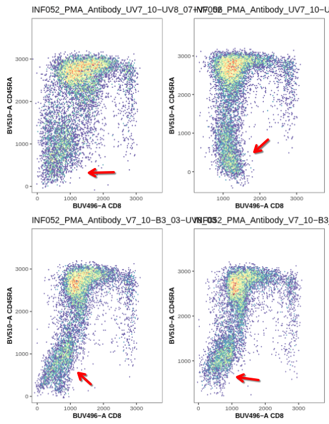

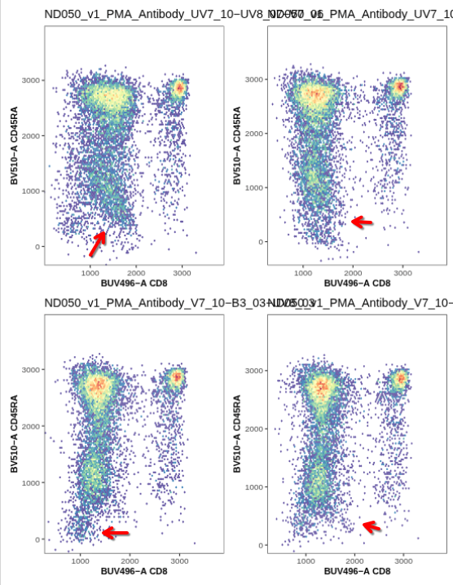

By contrast, the "B3" signature (lower right) seems to be more beneficial for BV421, with the second AF for UV7 not making much of an impact. 

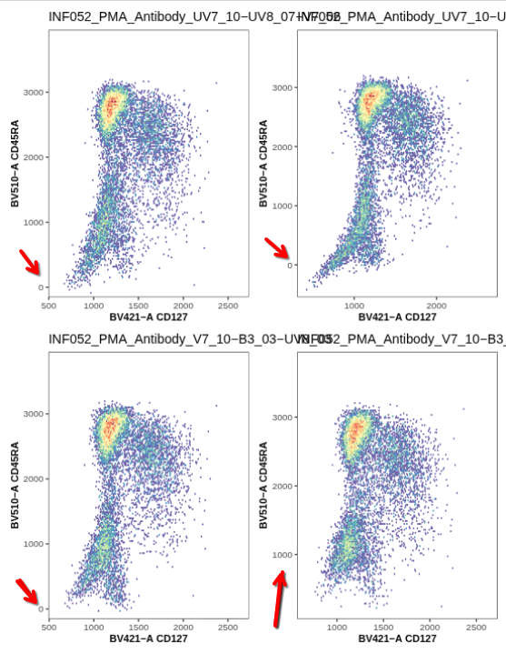

This same pattern bears out for the other Violet and Blue autofluorescence-similar fluorophores. 

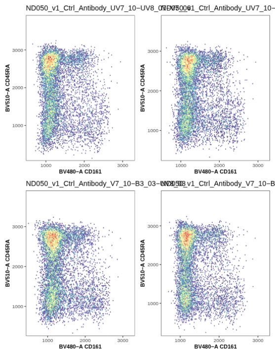

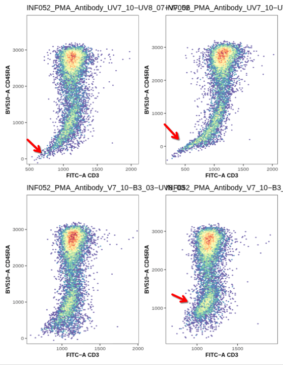

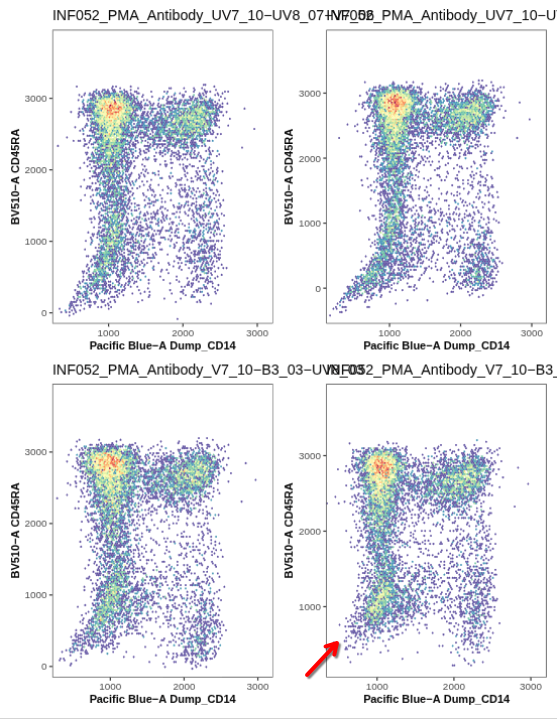

Finally, we still have a misbehaving population for Spark Blue 550 that is stubbornly resisting adjustment as can be seen below. 

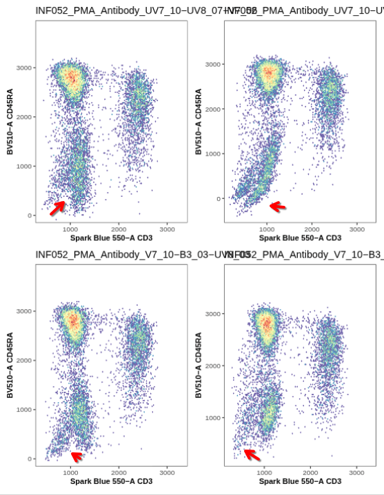

As we scroll through, while we notice that there was improvements for the cord blood PMA specimen when we added the UV7 primary signature, the effect was minimal across the board for the vast majority of markers except for BUV496. On the other hand, addition of the B3 variant from cord blood ended up significantly improving the unmixing for a lot of fluorophores. This is partly due to the location of the B3 secondary peak having substantial areas of overlap with other fluorophores in our panel, compared to the BUV496 peak in the early-mid UV laser detectors. We will go ahead and for now go ahead and add the B3 variant as our second autofluorescence. 

```{r}
AlternateMatrix <- Representative
ThisFluorophore <- "AF2"
ThisVariant <- "V7_10-B3_09-UV8_03"

UpdatedSignatureMatrix4 <- ComparisonMatrix |>
    dplyr::rows_update(
        AlternateMatrix |>
        dplyr::filter(Fluorophore %in% ThisVariant) |>
        dplyr::mutate(Fluorophore = ThisFluorophore),
        by = "Fluorophore"
    )
# UpdatedSignatureMatrix4 |> View()
```

However, while this would be sufficient to correctly unmix ND050 and likely INF052 control, we still have some issues present for INF052 PMA. So lets go ahead and consider doing a final round of iterative unmixing, but using the UV7 signature. 

### Third AF

Once again, this will require some data tidying to create an additional row in the signature matrix, where we can then swap in the UV7 signature contents into. At the same time, lets go ahead and alter the Fluorophore and Antigen values to make them a little more interpretable once they get into the .fcs file. 

```{r}
TheAF <- UpdatedSignatureMatrix4 |> filter(Fluorophore %in% "AF2")
TheAF <- TheAF |> mutate(Fluorophore = "AF3") |> mutate(Antigen = "AF_UV7")
UpdatedSignatureMatrix5 <- bind_rows(UpdatedSignatureMatrix4, TheAF)

UpdatedSignatureMatrix5 <- UpdatedSignatureMatrix5 |>
     mutate(Antigen = case_when(
    Fluorophore == "AF2" ~  "AF_B3", TRUE ~ Antigen))

# UpdatedSignatureMatrix5 |> View()

AlternateMatrix <- Representative
ThisFluorophore <- "AF3"
ThisVariant <- "UV7_10-UV8_07-V7_06"

FinalMatrix <- UpdatedSignatureMatrix5 |>
    dplyr::rows_update(
        AlternateMatrix |>
        dplyr::filter(Fluorophore %in% ThisVariant) |>
        dplyr::mutate(Fluorophore = ThisFluorophore),
        by = "Fluorophore"
    )
# FinalMatrix |> View()
```

In the process, I noticed that the antigens for FITC and Alexa Fluor 647 picked up the single-color antigen name, rather than that of their actual antigen in the full-stained panel, so we can go ahead and `mutate()` and `case_when()` to adjust these. 

```{r}
#| eval: FALSE

FinalMatrix <- FinalMatrix |> mutate(Antigen = case_when(
    Fluorophore == "Alexa Fluor 647" ~ "Va7.2",
    Fluorophore == "FITC" ~ "Va24Ja18",
    Fluorophore == "Pacific Blue" ~ "Dump",
    TRUE ~ Antigen
))
```

With this done, lets create a subfolder. 

```{r}
StashHere <- file.path(OutputLocation, "FinalAttempt")

if (!dir.exists(StashHere)){dir.create(StashHere)}
```

And we can now repeat our last iterative unmix run for this walkthrough. 

```{r}
#| eval: FALSE
walk(.x=fcs_files, .f=OldFashionedUnmix, 
    SignatureData=FinalMatrix, returnType="fcs",
    outpath=StashHere)
```

```{r}
TheseFCSFiles <- list.files(StashHere, pattern=".fcs", full.names=TRUE)
TheCytoset <- load_cytoset_from_fcs(TheseFCSFiles, truncate_max_range=FALSE, transformation=FALSE)
TheGatingSet <- GatingSet(TheCytoset)

SFC_Parameters <- colnames(TheGatingSet)
FluorophoresOnly <- SFC_Parameters[!stringr::str_detect(SFC_Parameters, "FSC|SSC|Time")]
Biexponential <-  flowjo_biexp_trans(channelRange=4096, maxValue=4194304,
  pos=5.62, neg=0, widthBasis=-1000)
MyBiexTransform <- transformerList(FluorophoresOnly, Biexponential)
transform(TheGatingSet, MyBiexTransform)
```

```{r}
#| eval: FALSE

IterateThroughTheseColumns <- FluorophoresOnly [!stringr::str_detect(FluorophoresOnly, "Spark Blue 550")]

AssembledPlots <- map(.x= IterateThroughTheseColumns, .f=Utility_UnityPlot, y="Spark Blue 550-A",
 GatingSet=TheGatingSet, sample.name="GUID", bins=120,
 removestrings=".fcs", marginsubset="root", gatesubset="root",
 returntype="patchwork", reference=NULL, clearance=0.2, gatelines=FALSE)
```

```{r}
#| eval: FALSE
Utility_Patchwork(x=AssembledPlots, filename="FinalUnmixing", outfolder=StashHere, thecolumns=1, therows=1, NotListofList = FALSE)
```

With the .pdf now generated, lets also generate a final hotspot matrix just for comparisons sake.

```{r}
#| eval: FALSE
FinalHotspot <- Hotspots(data=FinalMatrix,
 fileName="FinalHotspot",
 outpath = StashHere,
 returnType="plot")
```

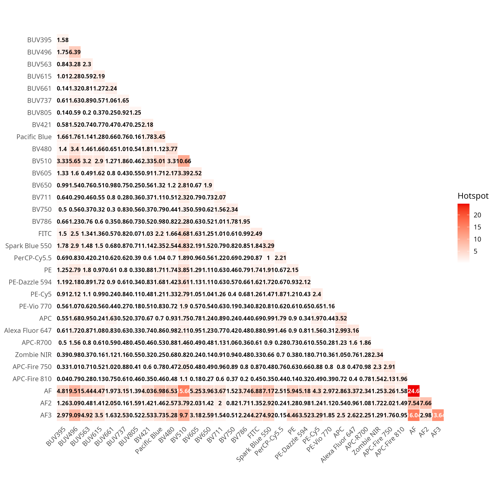

### Evaluating 3

At this point, we have various .pdfs, ranging from 1 autofluorescence (average with a peak at V7), to 2 autofluorescence (ultimately the main with peak at V7, and the variant with the brighter B3 secondary peak), to this final unmix variant (which contains both prior plus the UV7 peak signature). The question as we go between having 2 AF or 3 AF however, as we glance back at the hotspot start ballooning in values for BV510, is the presence of additional similar autofluorescences worthwhile, or will it complicate things more widely?

Lets take a quick look. Initially for BUV496, we had

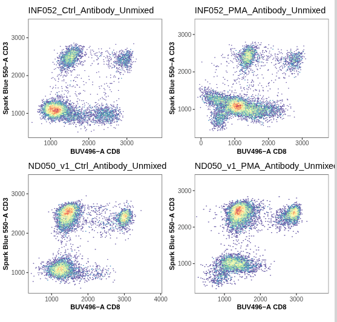

And for the 3 AF unmixing, we ended up with 

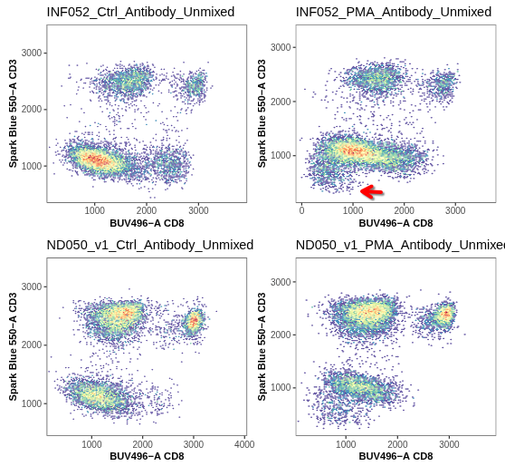

So the UV7 signature helped reduce the issue that we encountered for the INF052 PMA-ionomyicn condition, but didn't change things too dramatically for the other specimens. 

Lets continue to BV510

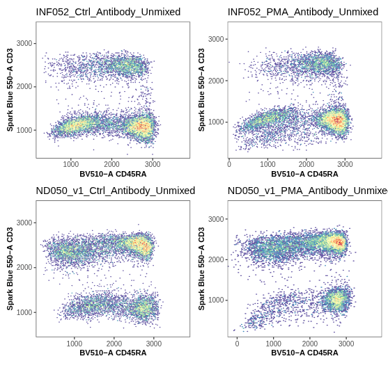

Still seeing a bit of a stretch for the PMA-ionomycin stimualted specimens for their negative populations, but lets hold off on that one for now. 

And of course, we would be remiss not to compare the initial APC

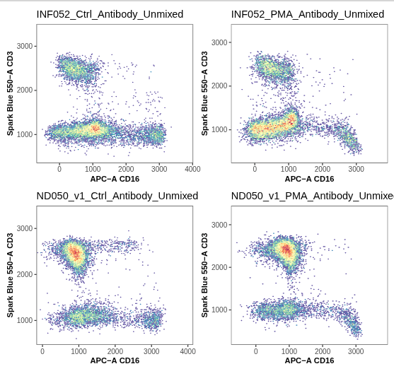

To our final APC

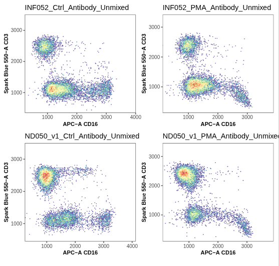

Still have the unmixing issue on the Spark Blue apparent, but the degraded tandem issue appears resolved. 

## Clean Up Gates

Finally, all the evaluation we have been doing so far has been occuring at the level of the entire .fcs file, which is convenient given how many iterative unmixings we just carried out. But what if we were only interested in one particular cell subset? What does our final unmixing look like in this context for our living T/NK cells that are the main focus of this panel? Lets go ahead and use the `flowGate` package workflow we encountered during [Clean up Gates](/course/SDY3080/SetUp.qmd) and add the neccessary gates. 

```{r}
CellGatingTable <- tibble::tribble(
  ~filterId,    ~dims,                          ~subset,      
  "singlets",   list("FSC-A", "FSC-H"),          "root",  
  "scatter",    list("FSC-A", "SSC-A"),      "singlets",
  "live",       list("FSC-A", "Zombie NIR-A"), "scatter",
  "NotBcells",  list("Pacific Blue-A", "BV711-A"), "live"       
)
```

```{r}
#| eval: FALSE
flowGate::gs_apply_gating_strategy(TheGatingSet, gating_strategy = CellGatingTable)
```

With this done, we can then go ahead and launch the Shiny app to check that these gates are indeed placed as intended. 


```{r}
#| eval: FALSE
flowGate::gs_apply_gate_check(gs=TheGatingSet, gate="singlets")
```

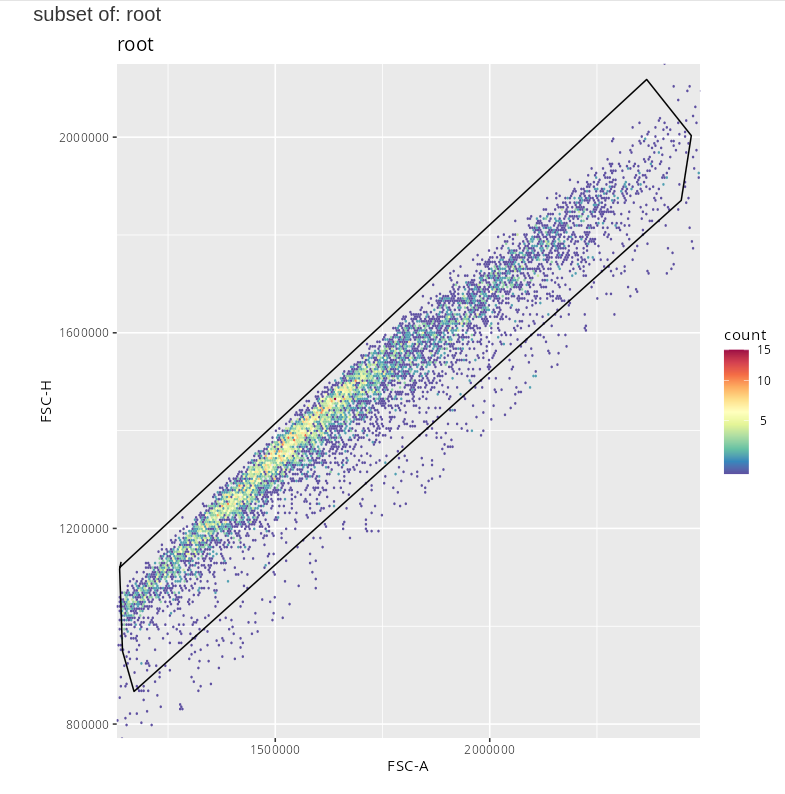

```{r}
#| eval: FALSE
flowGate::gs_apply_gate_check(gs=TheGatingSet, gate="scatter")
```

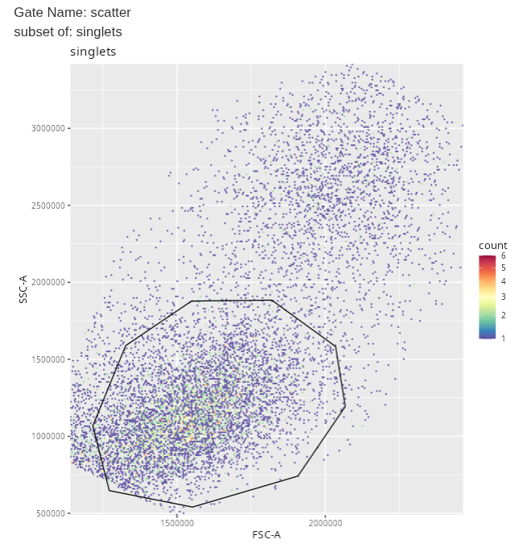

```{r}
#| eval: FALSE
flowGate::gs_apply_gate_check(gs=TheGatingSet, gate="live")
```

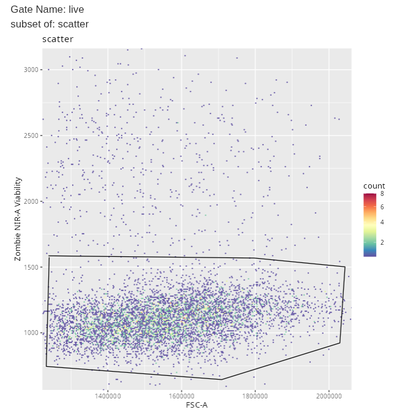

```{r}
#| eval: FALSE
flowGate::gs_apply_gate_check(gs=TheGatingSet, gate="NotBcells")
```

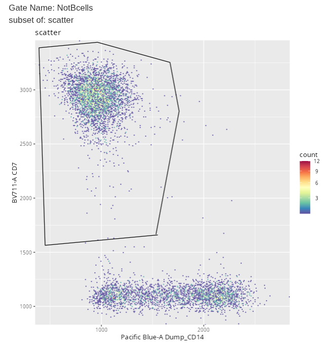

With all gates created, and their positions checked vs. the individual experiments, its now time to visualize them. We can alter the "gatesubset" argument we provide to `Utility_UnityPlot()` to only visualize our subset of interest, before outputting to the .pdf for visual inspection. 

```{r}
#| eval: FALSE

IterateThroughTheseColumns <- FluorophoresOnly [!stringr::str_detect(FluorophoresOnly, "Spark Blue 550")]

AssembledPlots <- map(.x= IterateThroughTheseColumns, .f=Utility_UnityPlot,
 y="Spark Blue 550-A", GatingSet=TheGatingSet, sample.name="GUID", bins=120,
 removestrings=".fcs", marginsubset="root", gatesubset="NotBcells",
 returntype="patchwork", reference=NULL, clearance=0.2, gatelines=FALSE)
```

```{r}
#| eval: FALSE
Utility_Patchwork(x=AssembledPlots, filename="FinalUnmixing_NotBcells",
 outfolder=StashHere, thecolumns=1, therows=1, NotListofList = FALSE)
```

### Evaluating Final

Alright, lets see how many of those last few unmixing issues are irrelevant simply because they are occuring on dying cells, or cell populations that were not the focus of this spectral flow cytometry panel. 

First up, looking at BUV496 at root


Cleans up quite nicely, so we are good to go for this autofluorescence similar fluorophore. Next up, BV510


A similar cleanup story, but still a bit over-dragging to the negative for ND050 PMA (its possible the 3 AF are dragging a bit too much). Next up BV605


The unmixing diagonal population was not a T cell or a NK, which makes our lives a bit simpler. 

And last, but certainly not forgotten, APC. Lets see what cell population is producing the reactive oxygen species that are converting our CD38 APC-Fire 810 to CD38 APC (and wrecking havoc on our CD16 APC frequencies)


And fortunately, this panel (and PhD project) lucked out, the tandem degradation is not affecting the target population of interest! 

### Saving GatingSet

And lastly, lets go ahead and save our GatingSet containing the clean up gates for future use. Alternatively, we could use `Downsampling()` from the R folder and extract out the cleaned population for use downstream, but we will save that step for next time after we evaluate data cleaning algorithms. 

```{r}
#| eval: FALSE
CleanUpGS <- file.path(OutputLocation, "CleanUpGS.gs")

save_gs(TheGatingSet, CleanUpGS)
```

# Take Away

In this walk-through, we figured out how to implement our everyday workflow for evaluating unmixing of our full .fcs files within an R context. In the process, we leveraged [new tools](/course/12_SpectralSignatures/index.qmd) from previous walk-throughs to allow us to swithc our problematic signatures from our unmixing matrices, and in turn leverage iterative unmixing to generate our differentially unmixed .fcs files that we could then visually screen side-by-side in order to make informed decisions on which was the better signature to utilize. Through the process of several iteration rounds, we saw that not all changes that we made were immediately helpful, vs those that made substantial difference for our overall unmixing. We also saw how specimen and condition autofluorescent issues could be worked through. 

As we currently stand, I am sure there are still additional tinkering that we could do to continue improving the unmixing of the full-stained .fcs files. But the more substantive issues have been addressed, and we will need to have some imperfect unmixing still present in the files to illustrate what kind of effects these may have on downstream unsupervised analysis algorithms in the next section. 

All in all, I hope this walk-through has been beneficial, not only in introducing how to carry out screening and iterative unmixing, but also to give you the tools to ask your own questions and get into good trouble. Whether OLS or a newer unmixing algorithm, there are [a lot of quirks](https://youtu.be/gmmPY4PdPuo?si=39FhO3TkVij8d3WV) about spectral flow cytometry where much remains unknown, and it will [take a community effort](https://youtu.be/_8ADO1avBXg?si=WrCieVI_u3IT11R-) of seeing something weird, and investigating it to build better community guidelines about what should be done in a given situation. 

This concludes the section for Cytometry Core. Next time we will move into the start of the Unsupervised Analysis module. Rather than profiling issues that can be found within our raw unmixing controls, we will check our files for other problems that can arise due to fluidic or laser related issues. There are multiple of these data cleaning algorithms, and we will do our best to provide a broader understanding of how they work, so that we can make informed decisions about whether the events that are being removed make sense or not. 


# Additional Resources

[BISCC 2026 - Unmixing Fundamentals](/course/15_EvaluatingUnmixing/BISCC2026_UnmixingFundamentals.pdf) Slides from our yearly Baltimore Introductory Spectral Cytometry course, covering the unmixing fundamentals for flow cytometry beginners (taught on the second day of the 5-day workshop)

[BISCC 2026 - Troubleshooting Unmixing](/course/15_EvaluatingUnmixing/BISCC2026_UnmixingControlTroubleshoot.pdf) Slides from our yearly Baltimore Introductory Spectral Cytometry course, covering troubleshooting unmixing (taught on the fourth day of the 5-day workshop)

[UMGCCC FCSR: Unmixing](https://youtu.be/qJh3TexeoBQ?si=YvCgaYtJiPFDXkXw) A recording of the unmixing portion of the training we do for our core facilities users in SpectroFlo, useful for some of the additional context of what I tend to look for or not look for when evaluating unmixing in SpectroFlo, especially for user panels that I am not as familiar with. Also applicable to what I do in R. 

# Take-home Problems

:::{.callout-tip title="Problem 1"}
For the final unmixed .fcs files, screen through them one more time and see if you can identify any remaining unmixing errors that were not yet addressed. As you identify them, make mental notes whether the MFI shifts they introduce are enough to substantially shift where the positive and negative populations start and end. We will circle back to these unmixing issues in the unsupervised analysis section to determine whether they are sufficiently different enough to introduce batch effects. 
:::

:::{.callout-tip title="Problem 2"}
At the beginning of the walk-through, we checked the residual plots for the full-stained .fcs files using the original unmixing matrix. Generate residual plots using the final unmixing matrix, visualize them with with `ggplotly()`, and characterize how the residuals shifted between specimens going from the initial unmixing with one autofluorescence, to the final unmixed version with 3. 
:::

:::{.callout-tip title="Problem 3"}
At a couple points, we swapped in alternate signatures, generated hotspot matrices, and subtracted them to identify the regions we expected to see improvement. But at the end of the walk-through, we added additional autofluorescent signatures to the matrix rather than swapping. Figure out how to implement a hotspot difference plot that would allow you to compare the final matrix vs. the original while working around the issue of different dimensions due to the additional autofluorescent rows.  Report back which fluorophores showed the greatest magnitude changes, for better or worse.
:::

::: {style="text-align: right;"}
[](https://www.gnu.org/licenses/agpl-3.0.en.html) [](http://creativecommons.org/licenses/by-sa/4.0/)
:::